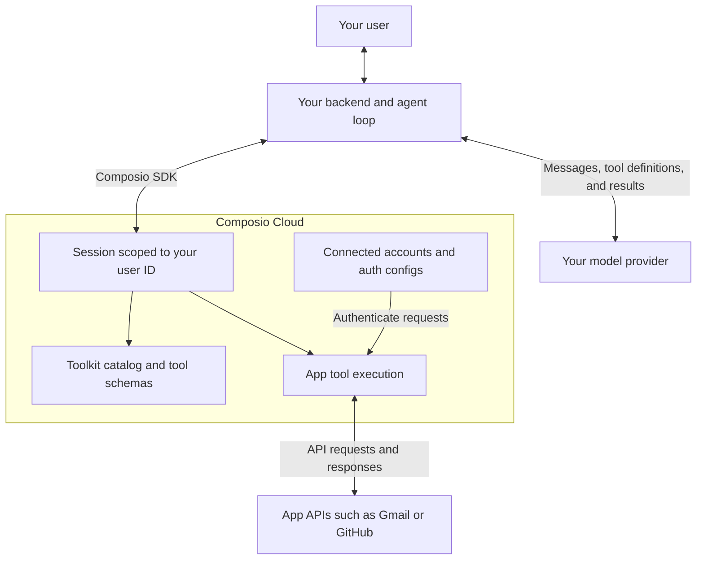
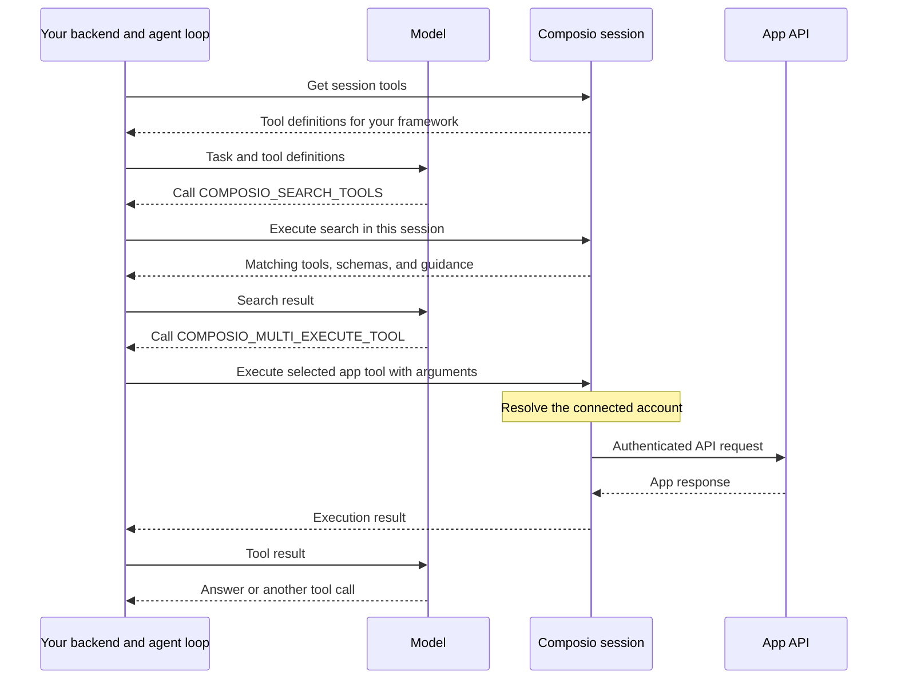
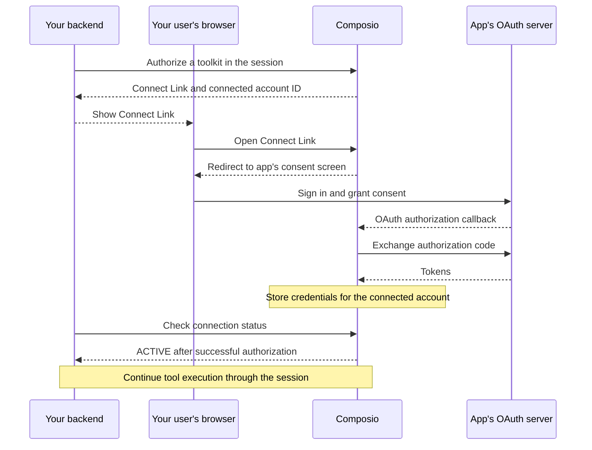
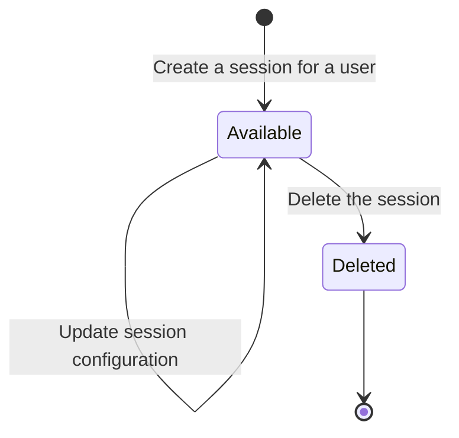

Composio connects your agent to app APIs through a session that scopes tools and connected accounts to one of your users. These diagrams show a hosted integration using the SDK. You can also connect an [MCP client to a session](/docs/sessions-via-mcp).

## High-level architecture

Your application runs the agent loop and calls the model. Composio provides tool definitions and executes app tools with the selected connected account.

Your backend maps the signed-in person to a stable Composio user ID. The session applies your [tool and account configuration](/docs/configuring-sessions). Your model chooses tool calls; your application or framework runs them through the session and sends results back to the model.

This diagram shows Composio-hosted app tools. [Local tools](/docs/extending-sessions/local-tools-and-toolkits) run in your process. For credential storage and deployment boundaries, see [Token custody architecture](/docs/security/token-custody).

## Request flow

A default session exposes meta tools for discovery and execution. This example assumes the required account is already connected.

Each call uses the same session ID. Your agent may repeat discovery and execution as it works through a task. With the [direct tools preset](/docs/configuring-sessions#direct-tools-preset), the model receives the selected app tools upfront and skips the search step.

See [Executing session tools](/docs/how-composio-works#executing-session-tools) for SDK and API examples, result handling, and requests for human approval.

## Auth flow

When an app needs a connection, generate a Connect Link and show it to your user. This diagram shows the standard hosted OAuth flow started by `session.authorize()`.

The SDK's connection request can wait for the account to become `ACTIVE`. Handle failed connections and timeouts before continuing. The agent can also request a Connect Link through `COMPOSIO_MANAGE_CONNECTIONS` during a conversation.

Your backend receives the link, account ID, and status. Composio uses the provider credentials during hosted execution. API-key connections and [imported credentials](/docs/authentication/importing-existing-connections) use different setup flows. See [Manual auth management](/docs/authentication/manually-authenticating) for connection checks and callbacks.

## Session lifecycle

Create a session for a new task context. Store its ID so later turns can retrieve the same session instead of creating another one.

`Available` and `Deleted` describe the lifecycle here; they aren't SDK status values.

Both SDKs expose `composio.sessions.create()`, `composio.sessions.use()`, `session.update()`, and `session.delete()`. Creation returns a new session ID. Retrieval keeps the existing ID and server-side context; updating changes configuration in place. Once deleted, the session can no longer be retrieved or used for execution.

A connected account belongs to the user and can be reused across sessions. Starting another session doesn't require another OAuth flow when a suitable active connection already exists. See [How sessions behave](/docs/how-composio-works#how-sessions-behave) for creation, reuse, and update examples.
