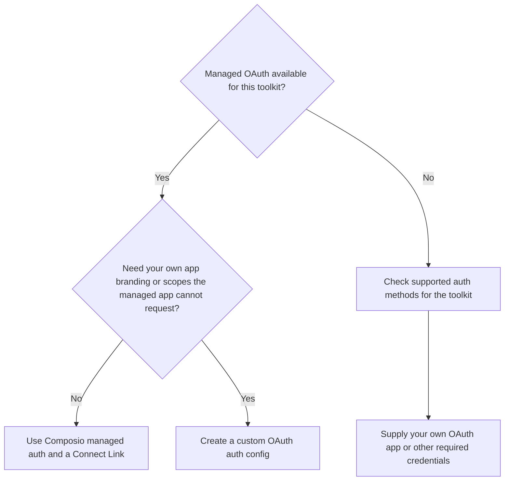

Composio handles OAuth. Call `session.authorize()` to get a hosted Connect Link where your user signs in. For toolkits with [Composio managed OAuth apps](/toolkits/managed-auth), you don't need to register an OAuth app or provide client credentials.

## Connect a user

Use Link Auth, the hosted Connect Link flow, for Composio managed OAuth. Set `COMPOSIO_API_KEY` on your backend, create a session for your application's user, then request a link for the toolkit they want to connect:

<Tabs groupId="language" items={['Python', 'TypeScript', 'API']} persist>
<Tab value="Python">
```python
from composio import Composio

composio = Composio()
session = composio.create(user_id="user_123")
connection_request = session.authorize("gmail")

# Open this URL or redirect the user to it
print(connection_request.redirect_url)
```
</Tab>
<Tab value="TypeScript">
```typescript
import { Composio } from '@composio/core';
const composio = new Composio();
const session = await composio.create("user_123");
const connectionRequest = await session.authorize("gmail");

// Open this URL or redirect the user to it
console.log(connectionRequest.redirectUrl);
```
</Tab>
<Tab value="API">
```bash
SESSION_ID=$(curl -s -X POST https://backend.composio.dev/api/v3.1/tool_router/session \
  -H "x-api-key: $COMPOSIO_API_KEY" \
  -H "Content-Type: application/json" \
  -d '{"user_id": "user_123"}' | jq -r '.session_id')

# Open this URL or redirect the user to it
curl -s -X POST https://backend.composio.dev/api/v3.1/tool_router/session/$SESSION_ID/link \
  -H "x-api-key: $COMPOSIO_API_KEY" \
  -H "Content-Type: application/json" \
  -d '{"toolkit": "gmail"}' | jq -r '.redirect_url'
```
</Tab>
</Tabs>

After the user opens the link and grants access, Composio stores their connection and refreshes OAuth tokens for you. Generating a link doesn't mean authentication has completed. Wait for the connected account to become `ACTIVE` before running tools. See [Manual auth management](/docs/authentication/manually-authenticating#authorize-a-toolkit) for waiting, callbacks, and connection-status checks.

## Behind the scenes

These three terms describe different parts of authentication:

| Term | What it means | Example |
| --- | --- | --- |
| Auth config | Settings for how a toolkit authenticates, including its auth method, scopes, and OAuth app credentials. Your own app credentials are optional when managed auth is available. | One Gmail config, identified by an `ac_...` ID, can serve many users. |
| Connected account | One user's connection to a toolkit, with the credentials Composio stores for that connection. | A user's work Gmail account, identified by a `ca_...` ID. |
| Auth link | A temporary URL, also called a Connect Link, where a user completes authentication. | The `redirect_url` in Python and API responses, or `redirectUrl` in TypeScript. |

An auth link starts a connection flow. It isn't the connected account or the [agent session](/docs/how-composio-works). Creating an auth config in the dashboard doesn't connect a user. The user must complete the link flow before their connected account becomes active.

<AuthConfigFlow />

## Choose managed or custom auth

Start with Composio managed auth when it's available. Use your own OAuth app when you need your app's consent-screen branding or permissions the managed app can't request.



Check [Managed OAuth apps](/toolkits/managed-auth) for availability. For custom OAuth, follow [Managed vs custom auth](/docs/authentication/custom-app-vs-managed-app#create-a-custom-auth-config) and the [OAuth2 setup guides](https://composio.dev/auth). Pass your auth config ID in `auth_configs` in Python or the API, or `authConfigs` in TypeScript, when creating the session. Creating the config alone doesn't select it for a session.

## Map tools to scopes

Scopes are the permissions shown on the provider's consent screen. Request only what your tools need to keep that screen focused.

1. List the tools your agent will use. Use the experimental [scope recommendations](/docs/authentication/controlling-scopes#choose-scopes-for-your-tools) to map those tools to a least-privilege scope set. Review conditional and required scopes before applying the recommendation.
2. [Set the scope list on an auth config](/docs/authentication/controlling-scopes#set-scopes-with-composio-managed-auth). You can reduce scopes while keeping Composio's managed OAuth app. Use your own app if the managed app isn't approved for the scopes you need.
3. [Pass that auth config to the session](/docs/authentication/controlling-scopes#use-the-auth-config-in-a-session), then have users connect through it.

<Callout type="warn">
Changing a config's scopes applies to new connections. Existing connections keep their previous grants until the user re-authenticates. Restricting the session's available tools doesn't change the permissions already granted to a connected account.
</Callout>

## Debug authentication failures

Start with the connected account ID from the connection request. [Retrieve the account](/reference/api-reference/connected-accounts/getConnectedAccountsByNanoid) and inspect `status` and `status_reason` in Python or the API, or `statusReason` in TypeScript. Check that its user and auth config match the session you intended to use.

| Symptom | What to check and do |
| --- | --- |
| Wait times out or account stays `INITIATED` | Confirm the user opened the Connect Link and finished consent. A wait timeout alone doesn't mean the provider rejected the connection. Check its current status before retrying. |
| Account is `FAILED` | Read the status reason for the failed attempt. Check for denied consent or incorrect auth config credentials, fix the cause, then generate a new link. |
| Account is `EXPIRED` or `REVOKED` | Ask the user to reconnect through a new Connect Link. See [Connection lifecycle](#connection-lifecycle). |
| Provider reports `redirect_uri_mismatch` | For custom OAuth, the provider's registered redirect URI must exactly match `oauth_redirect_uri` in your auth config. Your application's post-auth `callback_url` is a separate setting. |
| Consent is blocked, or a tool reports missing permissions | Check the scopes on the selected config and whether the OAuth app is approved for them. Apply [scope changes](/docs/authentication/controlling-scopes), then reconnect the user. |
| The session uses the wrong auth config | Pass the intended config ID, keyed by toolkit, when creating the session. Check that the config and session belong to the same Composio project. |
| Legacy `initiate()` call is rejected for managed OAuth | Use hosted Link Auth. With sessions, call `session.authorize()`. For direct SDK calls, [migrate to `connected_accounts.link()` or `connectedAccounts.link()`](/docs/auth-configuration/migrating-initiate-to-link). |

## Associate connections with your users

A [`userID`](/docs/how-composio-works) identifies the person your agent acts for in your app. Use a stable database ID, and derive it from your authenticated application user on your backend. Reuse it across sessions so Composio can find that user's connected accounts.

Don't share a value such as `default` across users in production. It puts their connections under the same identity. One user can have [multiple connected accounts](/docs/authentication/managing-multiple-connected-accounts), such as work and personal Gmail.

## How Composio handles authentication

By default, sessions include the [`COMPOSIO_MANAGE_CONNECTIONS`](/toolkits/meta-tools/manage_connections) meta-tool. When a tool needs an account, the agent can use it to return a Connect Link during chat. You can also generate a link yourself with `session.authorize()` for onboarding or a settings page, as shown above.

<ManageConnectionsVisual />

## In-chat authentication

<MediaSplit>
<div>

The agent posts the Connect Link straight into the conversation. The user clicks it, signs in, and the agent retries the tool and continues. No auth UI for you to build.

</div>

<InChatAuthTerminal
  task="Summarize my emails from today"
  toolkit="Gmail"
  toolkitSlug="gmail"
  tool="GMAIL_FETCH_EMAILS"
  toolArgs="newer_than: 1d"
  toolResult="12 emails"
  connectUrl="https://connect.composio.dev/link/ln_abc123"
  result="Here's a summary of your emails from today..."
/>
</MediaSplit>

You can also call `COMPOSIO_MANAGE_CONNECTIONS` yourself, intercept the Connect Link, and surface it wherever you need: DM it to the user, render it in your own UI, or email it. See [redirect auth links](/examples/general-agent-with-pi#redirect-auth-links) for a worked example.

### Custom callback URL

To send users back to your app after they connect, pass a `callback_url`:

<Tabs groupId="language" items={['Python', 'TypeScript', 'API']} persist>
<Tab value="Python">
```python
session = composio.create(
    user_id="user_123",
    manage_connections={"callback_url": "https://yourapp.com/chat"},
)
```
</Tab>
<Tab value="TypeScript">
```typescript
import { Composio } from '@composio/core';
const composio = new Composio({ apiKey: 'your_api_key' });
// ---cut---
const session = await composio.create("user_123", {
  manageConnections: { callbackUrl: "https://yourapp.com/chat" },
});
```
</Tab>
<Tab value="API">
```bash
curl -X POST https://backend.composio.dev/api/v3.1/tool_router/session \
  -H "x-api-key: $COMPOSIO_API_KEY" \
  -H "Content-Type: application/json" \
  -d '{"user_id": "user_123", "manage_connections": {"enable": true, "callback_url": "https://yourapp.com/chat"}}'
```
</Tab>
</Tabs>

## Connection lifecycle

For OAuth, Composio refreshes access tokens automatically before they expire, so connections stay `ACTIVE` with no work from you. If a refresh token is revoked or expires, the connection moves to `EXPIRED` and the user has to reconnect.

<ConnectionRefreshVisual />

Catch this before a tool call fails by subscribing to the `composio.connected_account.expired` event on a [webhook subscription](/reference/api-reference/webhook-subscriptions). When it fires, use `session.authorize()` to send the user a fresh Connect Link to re-authenticate.

## Where credentials live

When users connect through a Connect Link and your agent acts through tools, your application never handles their OAuth tokens. Composio stores each connected account's credentials encrypted at rest and refreshes OAuth tokens before they expire. When your agent calls a tool, your backend sends a user ID or connected account ID plus the tool arguments. Composio adds the credential to the provider request server-side and returns the provider's response. Your application and the model receive tool results, not tokens.

- **No token export.** Connected-account API responses redact credentials by default, for both Composio-managed and custom auth configs. Reading account state isn't a supported way to retrieve tokens.
- **Raw API access without the token.** For endpoints a tool doesn't cover, [Proxy Execute](/docs/extending-sessions/proxy-execute) sends an authenticated request to the provider and returns the response. It requires its own API key permission.
- **Least-privilege keys and sessions.** [Scoped API keys](/reference/authenticating-to-composio/project-api-key-permissions) separate session management from tool execution, and [session configuration](/docs/configuring-sessions) limits which toolkits and tools an agent can call.
- **Custody you choose.** In the default Composio Cloud deployment, Composio holds the encrypted credentials. Private VPC, self-hosted, and customer-managed key deployments change that boundary. With customer-managed keys, a proxy in your cloud decrypts credentials under your KMS keys, and Composio doesn't hold the key material.

If you [import existing credentials](/docs/authentication/importing-existing-connections), your application handles those tokens once before sending them to Composio. See [Token custody architecture](/docs/security/token-custody) for the full request flow, redaction scope, and [deployment options](/docs/security/token-custody#deployment-options).

Already have your own tools or agent framework? Follow [Managed authentication for your own tools](/docs/authentication/managed-auth-for-custom-tools) to connect users and call provider APIs without handling their tokens. You don't need predefined Composio tools, MCP, or an LLM.

## Authentication guides

<Cards>
  <Card title="Manual auth management" href="/docs/authentication/manually-authenticating" description="Generate Connect Links yourself, check connection status, and disable in-chat prompts." />
  <Card title="Multiple connected accounts" href="/docs/authentication/managing-multiple-connected-accounts" description="Let one user choose between work, personal, or other accounts." />
  <Card title="Shared connections" href="/docs/extending-sessions/shared-connections" description="Share one connected account with a controlled set of users." />
  <Card title="Import existing connections" href="/docs/authentication/importing-existing-connections" description="Bring credentials your application already stores into Composio." />
  <Card title="Managed vs custom auth" href="/docs/authentication/custom-app-vs-managed-app" description="Decide whether to use Composio credentials or your own OAuth app." />
  <Card title="Programmatic auth configs" href="/docs/authentication/programmatic-auth-configs" description="Create auth configs in code and attach them to sessions." />
  <Card title="Control OAuth scopes" href="/docs/authentication/controlling-scopes" description="Choose the permissions requested when a user connects." />
  <Card title="White-label authentication" href="/docs/authentication/white-labeling-authentication" description="Use your own OAuth app and remove Composio branding." />
</Cards>
