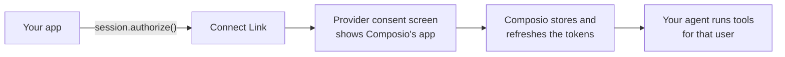

A Composio-managed app is an OAuth app that Composio registers with a provider, such as Google, GitHub, or Slack, and shares across Composio customers. When you connect a user to a toolkit without your own OAuth app, the user authorizes Composio's managed app.

Managed apps work in production. You skip the provider's developer portal, client credentials, and app review, and connect users right away.

## How a managed app works



For a toolkit with a managed app, Composio maintains:

- the OAuth app registration with the provider, including its client ID, client secret, and redirect URI
- the scopes the app is approved for
- webhook ingress for realtime triggers, so you don't set up [custom OAuth webhooks](/docs/setting-up-triggers/custom-oauth-webhooks)

You keep your own user IDs and sessions. Composio stores each user's tokens and refreshes them, the same as with your own OAuth app.

## Use a managed app

You don't create anything. A session uses the managed app for any toolkit you don't pass in `authConfigs`. Send the user a Connect Link and they sign in to the provider:

<Tabs groupId="language" items={['Python', 'TypeScript', 'API']} persist>
<Tab value="Python">
```python
from composio import Composio

composio = Composio()
session = composio.create(user_id="user_123")
connection_request = session.authorize("gmail")

# Send the user to this URL to connect their account
print(connection_request.redirect_url)
```
</Tab>
<Tab value="TypeScript">
```typescript
import { Composio } from '@composio/core';
const composio = new Composio({ apiKey: 'your_api_key' });
// ---cut---
const session = await composio.create('user_123');
const connectionRequest = await session.authorize('gmail');

// Send the user to this URL to connect their account
console.log(connectionRequest.redirectUrl);
```
</Tab>
<Tab value="API">
```bash
SESSION_ID=$(curl -s -X POST https://backend.composio.dev/api/v3.1/tool_router/session \
  -H "x-api-key: $COMPOSIO_API_KEY" \
  -H "Content-Type: application/json" \
  -d '{"user_id": "user_123"}' | jq -r '.session_id')

# Send the user to this URL to connect their account
curl -s -X POST https://backend.composio.dev/api/v3.1/tool_router/session/$SESSION_ID/link \
  -H "x-api-key: $COMPOSIO_API_KEY" \
  -H "Content-Type: application/json" \
  -d '{"toolkit": "gmail"}' | jq -r '.redirect_url'
```
</Tab>
</Tabs>

Not every toolkit has a managed app. Check the [Managed OAuth apps](/toolkits/managed-auth) catalog, or read the toolkit's `composio_managed_auth_schemes` as shown there. A toolkit without one needs your own OAuth app and a [custom auth config](/docs/authentication/custom-app-vs-managed-app#create-a-custom-auth-config).

To check which kind of config an existing connection uses, read `is_composio_managed` (Python and API) or `isComposioManaged` (TypeScript) on the auth config or connected account. The dashboard labels managed configs "Default (Composio-managed)".

## What's shared and what's yours

| | Composio-managed app | Your own OAuth app |
| --- | --- | --- |
| OAuth app registration | Composio | You |
| Name on the provider's consent screen | Composio's app | Your app |
| Scopes | A default set per toolkit, adjustable within what Composio's app requests | Any scope the provider approves for your app |
| Provider rate limits that apply per OAuth app | Shared with other Composio customers | Your own |
| Connect Link branding | Your logo and app title | Your logo and app title |
| Token storage and refresh | Composio | Composio |
| Tokens in API responses | Always redacted | Follow your project's masking setting |
| Realtime trigger webhooks | Set up by Composio | You [configure them](/docs/setting-up-triggers/custom-oauth-webhooks) where the provider requires it |

Owning the OAuth app changes which app the provider sees. Composio still stores the tokens either way. See [token custody](/docs/security/token-custody#oauth-app-ownership-and-token-custody).

## Scopes

Each managed app requests a default set of scopes for its toolkit. You can narrow or change them with a `scopes` field on a managed auth config, but only within what Composio's app is set up to request. See [Set scopes with Composio managed auth](/docs/authentication/controlling-scopes#set-scopes-with-composio-managed-auth).

A scope outside that set needs your own OAuth app. For Google toolkits, confirm a different scope set with [Composio support](mailto:support@composio.dev) before you rely on it, because Google approves scopes per OAuth app.

## Provider rate limits

Some providers meter requests per OAuth app as well as per user. On a managed app, every Composio customer's connections draw from that per-app limit together, so you may run into shared provider rate limits as your usage grows.

When a provider limits a request, the provider's error comes back in the tool result. [Avoid and recover from rate limits](/docs/poc-to-prod/avoid-rate-limits) shows how to spot it, retry, and send fewer calls. For higher volume, we recommend your own OAuth app, which gets its own per-app limit.

## Consent screen and branding

On the provider's consent screen, users see Composio's app name, because they're authorizing Composio's app. Only your own OAuth app puts your name there.

The Connect Link page before the consent screen is yours to brand on a managed app too. See [Customizing the Connect Link](/docs/authentication/white-labeling-authentication#customizing-the-connect-link).

## Toolkits with more than one managed app

Slack has two managed apps with different Slack approval status, rate limits, and triggers. See the Slack section of [Managed OAuth apps](/toolkits/managed-auth) to pick one.

## When to use your own OAuth app

A managed app is a good fit until one of these applies:

- You need dedicated provider rate limits for higher volume.
- You need your app name on the consent screen.
- You need a scope that Composio's app doesn't request.
- You connect to a custom instance, such as a private Salesforce subdomain.

You can mix both. Use your own OAuth app for some toolkits and managed apps for the rest. [Managed vs custom auth](/docs/authentication/custom-app-vs-managed-app) covers the decision and the setup.

If users are already connected through a managed app, [Move to your own OAuth app](/docs/migration-guide/managed-to-own-app) shows how to switch without breaking their connections. Each user reconnects once, so moving earlier means fewer reconnects.

## Next

<Cards>
  <Card icon={<Key />} title="Managed OAuth apps" href="/toolkits/managed-auth" description="Check which toolkits have a Composio-managed app" />
  <Card icon={<RouteIcon />} title="Managed vs custom auth" href="/docs/authentication/custom-app-vs-managed-app" description="Decide when to use your own OAuth app and set it up" />
  <Card icon={<Zap />} title="Avoid and recover from rate limits" href="/docs/poc-to-prod/avoid-rate-limits" description="Spot which limit you hit, retry well, and shape traffic" />
</Cards>
