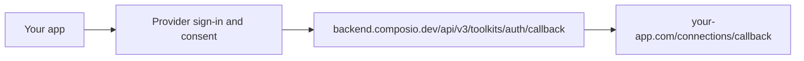

You can brand the hosted Connect Link or build your own connection UI with a custom OAuth app. Neither option removes the provider's sign-in and consent screens, and a callback forwarder still sends the browser to Composio.

## Choose your connection UI

| Mode | How you start it | What you control | What remains external |
|------|------------------|------------------|-----------------------|
| Branded hosted Connect Link | `session.authorize()` or `connectedAccounts.link()` | Logo, app title, theme, and your post-auth page | Composio hosts the connection UI; the provider hosts sign-in and consent |
| App-owned connection UI | `connectedAccounts.initiate()` with your custom OAuth config, where supported | Your connect button, any required input form, progress, and success/error screens | Provider sign-in and consent, plus Composio's OAuth callback |

For the hosted path, create an auth config, then run this on your server with a project API key:

<Tabs groupId="language" items={['Python', 'TypeScript', 'API']} persist>
<Tab value="Python">
```python
from composio import Composio

composio = Composio()
request = composio.connected_accounts.link(
    user_id="user_123",
    auth_config_id="ac_your_github_config",
    callback_url="https://your-app.com/connections/callback",
)
```
</Tab>
<Tab value="TypeScript">
```typescript
import { Composio } from '@composio/core';

const composio = new Composio();
const request = await composio.connectedAccounts.link(
  'user_123',
  'ac_your_github_config',
  { callbackUrl: 'https://your-app.com/connections/callback' },
);
```
</Tab>
<Tab value="API">
```bash
export COMPOSIO_API_KEY="your_project_api_key"

curl --request POST \
  --url https://backend.composio.dev/api/v3.1/connected_accounts/link \
  --header "x-api-key: $COMPOSIO_API_KEY" \
  --header "Content-Type: application/json" \
  --data '{
    "auth_config_id": "ac_your_github_config",
    "user_id": "user_123",
    "callback_url": "https://your-app.com/connections/callback"
  }' | jq '{connected_account_id, redirect_url}'
```
</Tab>
</Tabs>

Set `COMPOSIO_API_KEY` in your server environment; the API option also requires cURL and `jq`. Replace the auth config ID with your project's config and derive `user_id` from your authenticated application session, not a browser-supplied field. Store the returned `connected_account_id` (`request.id` in the SDKs) against that user on your server before sending the browser to `redirect_url` (`request.redirect_url` in Python or `request.redirectUrl` in TypeScript). [Verify the connection](#verify-the-connection-on-your-server) before showing success.

Use [your own OAuth app](#using-your-own-oauth-apps) to change the provider consent-screen identity in either mode. Use an application `callbackUrl` to return to your product after authentication. If you don't want the hosted connection page, follow [Build an app-owned connection UI](#build-an-app-owned-connection-ui).

<Callout type="warn" title="Branding is not domain replacement">
Connect Link branding doesn't change its `connect.composio.dev` host. A custom OAuth app doesn't remove provider domains or Composio's callback domain. The setup below doesn't provide a CNAME or a self-hosted Connect Link.
</Callout>

## Customizing the Connect Link

The Connect Link is the hosted page your users see when connecting their accounts. By default it shows Composio branding on a neutral light theme. You can swap in your logo and name, then restyle the whole page to match your product.

Everything here lives in **Project Settings** → [**White Labeling**](https://dashboard.composio.dev/~/project/settings/auth-screen?utm_source=docs&utm_medium=content&utm_campaign=docs-white-labeling-authentication). Changes apply to every Connect Link flow across all toolkits, for both [in-chat](/docs/authentication#in-chat-authentication) and [manual](/docs/authentication/manually-authenticating) authentication. Each project has one branding and one theme, so if you need a different look per product, use separate projects.

### Logo and name

1. Go to **Project Settings** → **White Labeling**, and open the **Branding** tab.
2. Set your **App Title** and upload your **Logo** (a square JPEG or PNG, 256×256 to 1024×1024 pixels).

The logo replaces the Composio mark at the top of the page, and the app title replaces "Composio" in the "...wants to connect to your account" heading.

<Callout>
This only changes the Composio-hosted page. The provider's consent screen gets its app identity from the OAuth credentials, not this theme. To change that identity, set up [your own OAuth app](#using-your-own-oauth-apps).
</Callout>

### Colors, fonts, and per-element styling

Open the **Styling** tab to restyle the entire Connect Link page. A live preview sits beside the controls and updates as you edit, and you can preview each state of the flow with the **Welcome**, **Form**, **Success**, and **Error** tabs.

<Figure src="/images/auth-screen-theme-editor.png" alt="The White Labeling editor with a live preview on the left and styling controls on the right" caption="Editing colors, fonts, and per-element styling with a live preview of the Connect Link" />

Set the page-wide defaults first:

- **Seed colours** for the page background, card, foreground text, and primary accent, plus secondary and tertiary accents for decorative touches.
- **Typefaces**: a display font for headings and a body font, each chosen from a curated set. The default is ABC Diatype.
- **Geometry**: corner radius and border width, which set the roundness and outline weight of cards, buttons, and inputs.

For finer control, select any element in the preview to style just that element. Editable elements cover the page and card surfaces, the heading, body, and field labels, the primary and secondary buttons, the input, the error notice, links, and the logo. Depending on the element you can set its colour, background, border, corner radius, shadow, and text size, weight, letter spacing, and case.

<Callout type="info" title="Contrast is enforced">
Text has to stay legible against its background. The editor shows the contrast ratio for each text element and disables **Save Changes** until every element passes, so you can't ship an unreadable page by accident.
</Callout>

Prefer to work in code? Flip the **JSON** toggle to edit the theme as a single object you can paste, review, or generate. Your logo and app title stay in the **Branding** tab, since the logo has no JSON representation.

### Language

The Connect Link shows English by default. To show it in your user's language, add a `locale` parameter to the Connect Link URL before you send it to the user. The Connect Link supports these languages:

| Language | `locale` value |
|----------|----------------|
| English | `en` (default) |
| Spanish | `es` |
| Simplified Chinese | `zh-CN` |

Use these values exactly as written. Any other value, including variants such as `es-MX` or `zh-cn`, shows English. The language stays the same for the whole flow, including the success or failure screen after the user returns from the OAuth provider.

<Tabs groupId="language" items={['Python', 'TypeScript', 'API']} persist>
<Tab value="Python">
```python
from urllib.parse import urlencode

connection_request = session.authorize("gmail")

if connection_request.redirect_url:
    # Show the Connect Link in Spanish
    connect_url = f"{connection_request.redirect_url}?{urlencode({'locale': 'es'})}"
    print(connect_url)
```
</Tab>
<Tab value="TypeScript">
```typescript
import { Composio } from '@composio/core';
const composio = new Composio({ apiKey: 'your_api_key' });
const session = await composio.create("user_123");
// ---cut---
const connectionRequest = await session.authorize("gmail");

if (connectionRequest.redirectUrl) {
  // Show the Connect Link in Spanish
  const connectUrl = new URL(connectionRequest.redirectUrl);
  connectUrl.searchParams.set("locale", "es");
  console.log(connectUrl.toString());
}
```
</Tab>
<Tab value="API">
```bash
# SESSION_ID is the session_id returned when you created the session
REDIRECT_URL=$(curl -s -X POST https://backend.composio.dev/api/v3.1/tool_router/session/$SESSION_ID/link \
  -H "x-api-key: $COMPOSIO_API_KEY" \
  -H "Content-Type: application/json" \
  -d '{"toolkit": "gmail"}' | jq -r '.redirect_url')

# Show the Connect Link in Spanish
echo "$REDIRECT_URL?locale=es"
```
</Tab>
</Tabs>

The `locale` parameter changes only the Connect Link's own text. Field names and help text on API key forms, error details from the provider, and the provider's own sign-in and consent screens keep their original language.

<Callout type="warn" title="Troubleshooting">
- **The provider consent screen still shows Composio:** configure [your own OAuth app](#using-your-own-oauth-apps), and confirm the connection uses that auth config.
- **Logo doesn't appear after uploading:** clear your browser cache or try incognito.
- **Upload fails with "failed to fetch":** retry or use a smaller image.
- **You see the Branding tab but no Styling tab:** theming is still rolling out. If it isn't enabled for your project yet, reach out. The logo and app title keep working in the meantime.
</Callout>

## Using your own OAuth apps

OAuth providers get the consent-screen name, logo, and publisher identity from your OAuth app, not the Connect Link theme. Register your own app and create a custom auth config to use it.

<Callout type="info" title="You don't need this for every toolkit">
Only white-label toolkits where users see a consent screen (Google, GitHub, Slack, etc.). Toolkits that use API keys don't show consent screens, so there's nothing to white-label. You can mix and match freely.
</Callout>

### Create the custom auth config

1. Register an OAuth app in the provider's developer portal. Configure its name, logo, support details, and the scopes your product needs. Complete any provider verification or publishing requirements before offering it to customers.
2. Register `https://backend.composio.dev/api/v3/toolkits/auth/callback` as the provider's authorized redirect URI. Set this same URL explicitly as `oauth_redirect_uri` in Composio. Some toolkit defaults use the supported legacy callback `/api/v1/auth-apps/add`; don't rely on a default that differs from your provider registration.
3. In the [dashboard's auth configs](https://dashboard.composio.dev/~/project/auth-configs?utm_source=docs&utm_medium=content&utm_campaign=docs-white-labeling-authentication), create an auth config for the toolkit. Select **OAuth2**, enable **Use your own developer credentials**, and enter the client ID, client secret, scopes, and redirect URI. Copy the resulting `ac_...` ID.
4. Keep the client secret and Composio API key on your server. Use separate OAuth apps and auth configs for environments that need different credentials or redirect URIs.

For code-based provisioning, see [Programmatic auth configs](/docs/authentication/programmatic-auth-configs#your-own-oauth2-credentials). Provider requirements vary; use the [toolkit's authentication guide](/toolkits) for supported schemes and required fields.

For sessions, select the custom config explicitly:

<Tabs groupId="language" items={['Python', 'TypeScript', 'API']} persist>
<Tab value="Python">
```python
from composio import Composio

composio = Composio()
session = composio.create(
    user_id="user_123",
    auth_configs={"github": "ac_your_github_config"},
)
request = session.authorize(
    "github",
    callback_url="https://your-app.com/connections/callback",
)
```
</Tab>
<Tab value="TypeScript">
```typescript
import { Composio } from '@composio/core';

const composio = new Composio();
const session = await composio.create('user_123', {
  authConfigs: { github: 'ac_your_github_config' },
});
const request = await session.authorize('github', {
  callbackUrl: 'https://your-app.com/connections/callback',
});
```
</Tab>
<Tab value="API">
```bash
SESSION_ID=$(curl -s --request POST \
  --url https://backend.composio.dev/api/v3.1/tool_router/session \
  --header "x-api-key: $COMPOSIO_API_KEY" \
  --header "Content-Type: application/json" \
  --data '{
    "user_id": "user_123",
    "auth_configs": {"github": "ac_your_github_config"}
  }' | jq -r '.session_id')

curl --request POST \
  --url "https://backend.composio.dev/api/v3.1/tool_router/session/$SESSION_ID/link" \
  --header "x-api-key: $COMPOSIO_API_KEY" \
  --header "Content-Type: application/json" \
  --data '{"toolkit": "github", "callback_url": "https://your-app.com/connections/callback"}'
```
</Tab>
</Tabs>

Set `COMPOSIO_API_KEY` in your server environment. Persist `request.id` with the authenticated user's connection attempt, then send the browser to `request.redirectUrl`. Without a session, use `connectedAccounts.link(userId, authConfigId, { callbackUrl })` or the cURL example above. These methods return a hosted Connect Link, not a page you host.

<Card icon={<Key />} title="Managed vs custom auth" href="/docs/authentication/custom-app-vs-managed-app" description="Choose which toolkits use your OAuth credentials." />

### Switching from Composio-managed to your own OAuth app

Existing connected accounts are tied to the auth config they were created with. Switching to a custom auth config affects new connections for that toolkit; existing users keep using their current connected accounts until they re-authenticate or you import/migrate their credentials.

- To use the custom config for new connections, pass `authConfigs` when creating or updating the session.
- Existing connections continue refreshing with their original auth config.
- To fully migrate an existing user, delete the old connected account and have them re-authenticate with the new auth config, or import their credentials into the new config where supported.

## Build an app-owned connection UI

For a toolkit that supports direct OAuth2 initiation with custom credentials, you can skip Connect Link and start authorization from your own UI. You own the connection form and status screens, but not the provider's sign-in or consent screen.

<Callout type="warn" title="Use a custom auth config for this path">
`initiate()` remains supported for custom auth configs. Its Composio-managed OAuth path has been retired. Use `link()` or `session.authorize()` for managed OAuth; don't treat them as a way to render the hosted UI inside your own app. See [Migrating from initiate to link](/docs/auth-configuration/migrating-initiate-to-link).
</Callout>

### Start authorization from your backend

1. Render your own **Connect GitHub** button and any toolkit-required fields. Check the toolkit's authentication requirements first; a generic button isn't enough for providers that require an account URL, shop name, or other initialization data.
2. When the signed-in user clicks, authorize the request in your backend. Select the toolkit and custom auth config from server-controlled values.
3. Create a connection using `initiate()`. Set `long_redirect_url` to request an unshortened authorization URL:

<Tabs groupId="language" items={['Python', 'TypeScript', 'API']} persist>
<Tab value="Python">
```python
from composio import Composio

composio = Composio()
request = composio.connected_accounts.initiate(
    user_id="user_123",
    auth_config_id="ac_your_github_config",
    callback_url="https://your-app.com/connections/callback",
    config={
        "auth_scheme": "OAUTH2",
        "val": {"status": "INITIALIZING", "long_redirect_url": True},
    },
)
```
</Tab>
<Tab value="TypeScript">
```typescript
import { Composio } from '@composio/core';

const composio = new Composio();
const request = await composio.connectedAccounts.initiate(
  'user_123',
  'ac_your_github_config',
  {
    callbackUrl: 'https://your-app.com/connections/callback',
    config: {
      authScheme: 'OAUTH2',
      val: { status: 'INITIALIZING', long_redirect_url: true },
    },
  },
);
```
</Tab>
<Tab value="API">
```bash
curl --request POST \
  --url https://backend.composio.dev/api/v3.1/connected_accounts \
  --header "x-api-key: $COMPOSIO_API_KEY" \
  --header "Content-Type: application/json" \
  --data '{
    "auth_config": {"id": "ac_your_github_config"},
    "connection": {
      "user_id": "user_123",
      "callback_url": "https://your-app.com/connections/callback",
      "state": {
        "authScheme": "OAUTH2",
        "val": {"status": "INITIALIZING", "long_redirect_url": true}
      }
    }
  }' | jq '{id, redirect_url: .connectionData.val.redirectUrl}'
```
</Tab>
</Tabs>

4. Store the returned `id`, authenticated application user, expected toolkit, and auth config as a pending attempt on your server. Return only the authorization URL to your frontend and navigate the browser to it. Don't send the raw API response or credentials to the browser or a model.
5. On return to your application callback, [verify the stored attempt and connected account](#verify-the-connection-on-your-server), then render your own result page. If the browser closes or never returns, keep the attempt pending until your application expires it; don't infer success.

For supported direct OAuth flows, the unshortened URL points to the provider rather than Composio's short-link redirect. Inspect the returned URL and test each toolkit before deployment. `long_redirect_url` controls URL shortening; it isn't a guarantee that every toolkit can skip all intermediate pages, and it doesn't change the return callback.

### Use the connection in a session

After verification, pass the connected account ID to a session for the same server-derived user:

<Tabs groupId="language" items={['Python', 'TypeScript', 'API']} persist>
<Tab value="Python">
```python
from composio import Composio

composio = Composio()
session = composio.create(
    user_id="user_123",
    auth_configs={"github": "ac_your_github_config"},
    connected_accounts={"github": "ca_verified_github_account"},
    manage_connections=False,
)
```
</Tab>
<Tab value="TypeScript">
```typescript
import { Composio } from '@composio/core';

const composio = new Composio();
const session = await composio.create('user_123', {
  authConfigs: { github: 'ac_your_github_config' },
  connectedAccounts: { github: 'ca_verified_github_account' },
  manageConnections: false,
});
```
</Tab>
<Tab value="API">
```bash
curl --request POST \
  --url https://backend.composio.dev/api/v3.1/tool_router/session \
  --header "x-api-key: $COMPOSIO_API_KEY" \
  --header "Content-Type: application/json" \
  --data '{
    "user_id": "user_123",
    "auth_configs": {"github": "ac_your_github_config"},
    "connected_accounts": {"github": ["ca_verified_github_account"]},
    "manage_connections": {"enable": false}
  }'
```
</Tab>
</Tabs>

Replace `ca_verified_github_account` with the ID your backend verified, not a browser-selected account. `manageConnections: false` disables the agent's connection manager, which can otherwise return hosted Connect Links for missing connections. Initiate missing connections from your own app, and don't call `session.authorize()`, which starts the hosted flow.

## Routing the callback through your domain

There are two different callback URLs:

| Setting | Who redirects to it | Purpose |
|---------|---------------------|---------|
| Provider `redirect_uri`, configured as `oauth_redirect_uri` in your auth config | OAuth provider | Receives the OAuth authorization response so Composio can complete the token exchange |
| Application `callbackUrl` (`callback_url` in REST/Python) | Composio after authentication | Returns the browser to your product so your backend can verify the result and show your UI |

Changing the application `callbackUrl` doesn't change the provider's `redirect_uri`. With the default provider callback, a direct flow follows:



The hosted path adds `connect.composio.dev` before the provider, and may show hosted completion UI when no application callback is set. Short links and provider-specific steps may add other hops.

### Optional: register your own provider callback endpoint

If the toolkit and provider support a custom redirect URI, you can register an HTTPS endpoint you control, such as `https://your-app.com/oauth/provider-callback`, in both the provider's OAuth app and the auth config's `oauth_redirect_uri`.

For an OAuth2 provider that returns the authorization response in a GET query, that endpoint must return a browser redirect to the fixed Composio callback, preserving the original query string, including `code`, `state`, or provider error parameters:

```http
HTTP/1.1 302 Found
Location: https://backend.composio.dev/api/v3/toolkits/auth/callback?<original-query-string>
Cache-Control: no-store
Referrer-Policy: no-referrer
```

This is a response shape, not a literal `Location` value. Append the original query without decoding and reconstructing its values. Keep the destination fixed; don't accept a redirect target from the incoming request. Don't exchange the code in this endpoint, fetch the callback server-side, or consume the provider's `state` as your application's attempt identifier.

<Callout type="warn" title="A 302 forwarder does not hide Composio">
The browser still visits `backend.composio.dev` after your endpoint. Your endpoint receives the authorization `code` and `state` in the request, even though it doesn't exchange the code for tokens. Disable query-string capture in access logs, error reports, analytics, and tracing for this route, including any CDN or reverse proxy in front of it. Don't render a page or load third-party resources before forwarding.
</Callout>

The custom endpoint changes the redirect URI registered with the provider and adds a browser hop. It doesn't make OAuth app-only or remove Composio from the address bar. Don't use this GET-query forwarding pattern for providers with a different response mode without confirming toolkit support.

<WhiteLabelFlow />

## Redirecting users after authentication

Pass an application `callbackUrl` when starting either flow to return to your product instead of the default hosted success page. The examples above use `https://your-app.com/connections/callback`. Keep this URL server-controlled, or validate it against an allowlist if your application supports multiple return destinations.

<Tabs groupId="language" items={['Python', 'TypeScript', 'API']} persist>
<Tab value="Python">
```python
connection_request = session.authorize(
    "gmail",
    callback_url="https://your-app.com/callback"
)
```
</Tab>
<Tab value="TypeScript">
```typescript
import { Composio } from '@composio/core';
const composio = new Composio({ apiKey: 'your_api_key' });
const session = await composio.create("user_123");
// ---cut---
const connectionRequest = await session.authorize("gmail", {
  callbackUrl: "https://your-app.com/callback",
});
```
</Tab>
<Tab value="API">
```bash
# SESSION_ID is the session_id returned when you created the session
curl -X POST https://backend.composio.dev/api/v3.1/tool_router/session/$SESSION_ID/link \
  -H "x-api-key: $COMPOSIO_API_KEY" \
  -H "Content-Type: application/json" \
  -d '{"toolkit": "gmail", "callback_url": "https://your-app.com/callback"}'
```
</Tab>
</Tabs>

The callback can include `status=success` or `status=failed` and `connected_account_id`. Treat these as navigation hints, not proof that the connection is active or belongs to the current user. See [callback parameters](/docs/authentication/manually-authenticating#redirecting-users-after-authentication).

## Verify the connection on your server

Before marking an integration connected:

1. Require your application's authenticated session. Retrieve its pending connection attempt from server-side storage. If you need to distinguish simultaneous attempts, include a fresh, unguessable attempt ID in your application `callbackUrl`, bind it to that session, and expire it after use. This is separate from the provider's OAuth `state`.
2. Match any callback `connected_account_id` against the ID saved when your backend started the attempt. Don't trust a callback `user_id`, an account ID from the browser, or `status=success` on its own.
3. Query Composio with your project API key, filtering by the saved account ID, the server-derived user, expected auth config, toolkit, and `ACTIVE` status:

<Tabs groupId="language" items={['Python', 'TypeScript', 'API']} persist>
<Tab value="Python">
```python
from composio import Composio

composio = Composio()
accounts = composio.connected_accounts.list(
    connected_account_ids=["ca_saved_connection_id"],
    user_ids=["user_123"],
    auth_config_ids=["ac_your_github_config"],
    toolkit_slugs=["github"],
    statuses=["ACTIVE"],
)
```
</Tab>
<Tab value="TypeScript">
```typescript
import { Composio } from '@composio/core';

const composio = new Composio();
// Use the public raw client to retain the saved-account ID filter.
const accounts = await composio.getClient().connectedAccounts.list({
  connected_account_ids: ['ca_saved_connection_id'],
  user_ids: ['user_123'],
  auth_config_ids: ['ac_your_github_config'],
  toolkit_slugs: ['github'],
  statuses: ['ACTIVE'],
});
```
</Tab>
<Tab value="API">
```bash
curl --get \
  --url https://backend.composio.dev/api/v3.1/connected_accounts \
  --header "x-api-key: $COMPOSIO_API_KEY" \
  --data-urlencode "connected_account_ids=ca_saved_connection_id" \
  --data-urlencode "user_ids=user_123" \
  --data-urlencode "auth_config_ids=ac_your_github_config" \
  --data-urlencode "toolkit_slugs=github" \
  --data-urlencode "statuses=ACTIVE" \
  | jq '{items: [.items[] | {id, status, is_disabled, toolkit, auth_config}]}'
```
</Tab>
</Tabs>

4. Require the saved account ID in the result, with the expected toolkit, auth config, and `ACTIVE` status. Require both the connection and auth config to be enabled (`is_disabled: false`). An empty result isn't success. The `user_id` field on individual account responses is deprecated, so don't rely on it being returned; use the user filter and your stored user-to-attempt binding.
5. Mark the attempt complete once and show your success UI. If it's still pending, show progress and check again from your backend. Handle failed, expired, cancelled, and abandoned attempts without enabling tool access.

This binds the connection to your *application* user. It doesn't prove which Google or GitHub identity they selected. If your product restricts the provider identity, fetch the provider's authenticated current-user profile using the verified connection and enforce that policy before enabling access. See [Identify the connected account](/docs/authentication/manually-authenticating#identify-the-connected-account). A display name or alias alone isn't an identity check.

Keep Composio API keys, OAuth client secrets, and tokens out of frontend code, model prompts, tool arguments, and logs. Handle authorization codes only in the callback route; don't copy them into UI payloads or model context. Return only the sanitized status and account label your UI needs.

## Deployment checklist

- **Consent:** Check the provider's actual consent screen for your app name, publisher details, and requested scopes. Complete required verification and test with an account outside your developer team.
- **URL chain:** Record the real browser navigation for each supported toolkit, including short links, Connect Link if used, provider domains, any forwarder, Composio's callback, and your application callback. Don't promise zero third-party domains.
- **Redirect configuration:** Match the provider registration and auth config's `oauth_redirect_uri` exactly. Confirm that the separate application `callbackUrl` is allowlisted and returns to your product.
- **Connection outcomes:** Exercise success, consent denial, provider error, closed tabs, expired attempts, and retries. Don't assume every cancellation produces a callback.
- **Ownership and status:** Reject mismatched attempt IDs, users, connected account IDs, toolkits, and auth configs. Enable access only after your backend finds the expected active connection and applies any provider-identity policy.
- **Secrets and logging:** Confirm no API key, client secret, or token reaches the frontend or model. Keep authorization codes confined to the callback route, and check CDN, application, analytics, and error logs for callback query capture.
- **Existing connections:** Test new connections with the custom config separately from accounts created with the old config. A branding change doesn't migrate them.

## Frequently asked questions

### Do I need a custom OAuth app for every toolkit?

No. Use one for OAuth toolkits where your product needs its own consent-screen identity, scopes, or quotas. API-key toolkits don't have an OAuth consent screen. You can mix managed and custom auth configs.

### Can each customer have different branding?

Each Composio project has one Connect Link app title, logo, and theme. Use separate projects if hosted flows need independent branding, and account for the extra provisioning. An app-owned UI controls its own appearance independently of the hosted theme.

### Can I remove every Composio domain with a redirect forwarder?

No. A 302 forwarder still navigates the browser to Composio. An app-owned UI can skip the hosted Connect Link for supported custom OAuth flows, but Composio's callback and the provider's pages remain part of the flow described here.

## Next

<Cards>
  <Card icon={<Key />} title="Managed vs custom auth" href="/docs/authentication/custom-app-vs-managed-app" description="Set up auth configs for OAuth apps, API keys, and toolkits without managed auth." />
  <Card title="B2B agent architecture" href="/docs/b2b-agents" description="Decide when customer-specific branding or credentials require separate projects." />
  <Card title="Production readiness" href="/docs/production-readiness" description="Test authentication, isolation, logs, and failure recovery before launch." />
</Cards>
