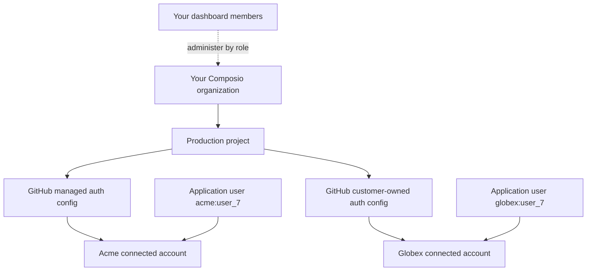

A B2B agent serves organizations with multiple members. Before writing integration code, decide who owns each app connection: an individual member or the customer workspace. That decision determines the Composio user ID and access model.

## Map your customers to Composio resources

A *tenant* is a customer workspace in your SaaS application. It doesn't have to be a Composio organization or project. Your application owns tenant membership and permissions.

| Resource | Purpose and boundary |
|---|---|
| Composio organization | Groups your Composio projects and dashboard members. Composio API rate limits apply across the organization. |
| Dashboard member | A person who signs in to administer Composio resources, subject to their role. This is separate from an application end user. |
| Project | Contains auth configs and connected accounts. A project API key authenticates your backend to that project. |
| Application user ID | An identifier you supply for the person or integration your agent acts for. It doesn't create a dashboard membership. Include the tenant in the ID when needed to keep identities unique. |
| Auth config | Defines a toolkit's authentication scheme, scopes, and app credentials. Multiple users can connect through the same config. A config isn't a tenant access-control policy. |
| Connected account | Stores one connection's provider credentials under an application user ID and auth config. Sessions select these accounts to execute tools. |



Keep [Composio API keys](/reference/authenticating-to-composio) on your server. A project key can reach resources across that project within its permissions; a tenant-prefixed user ID doesn't restrict the key itself. Resolve the tenant, user ID, auth config, and connected account from your authenticated application session and server-side records. Don't accept these IDs as authorization from a browser or model.

## Choose the connection owner

| Model | Use it when | Composio user ID example |
|---|---|---|
| Member-owned | Each member connects and acts through their own account | `org_42:user_7` |
| Workspace-owned | The organization connects one shared service account or integration | `org_42:integration` |

Use globally unique, immutable IDs. Prefixing your member ID with the workspace ID makes the tenant boundary explicit even when member IDs are only unique inside one workspace.

<Tabs groupId="language" items={['Python', 'TypeScript', 'API']} persist>
<Tab value="Python">
```python
from composio import Composio

composio = Composio()

workspace_id = "org_42"
member_id = "user_7"
composio_user_id = f"{workspace_id}:{member_id}"

session = composio.sessions.create(
    user_id=composio_user_id,
    toolkits=["slack", "salesforce"],
)
tools = session.tools()
```
</Tab>
<Tab value="TypeScript">
```typescript
import { Composio } from "@composio/core";

const composio = new Composio();

const workspaceId = "org_42";
const memberId = "user_7";
const composioUserId = `${workspaceId}:${memberId}`;

const session = await composio.create(composioUserId, {
  toolkits: ["slack", "salesforce"],
});
const tools = await session.tools();
```
</Tab>
<Tab value="API">
```bash
curl -X POST https://backend.composio.dev/api/v3.1/tool_router/session \
  -H "x-api-key: $COMPOSIO_API_KEY" \
  -H "Content-Type: application/json" \
  -d '{
    "user_id": "org_42:user_7",
    "toolkits": { "enable": ["slack", "salesforce"] }
  }'
```
</Tab>
</Tabs>

<Callout type="warn" title="Do not collapse every member into one tenant ID">
If members should use separate accounts, do not create all sessions with only the workspace ID. That would place their connections in the same user scope. Use a member-scoped ID and enforce your product's workspace authorization before creating or restoring a session.
</Callout>

## Start with one project per environment

Use one Composio project for each application environment, such as development, staging, and production. Keep the tenant boundary in your application and `user_id` model.

Customer-owned OAuth credentials alone don't require a separate project. You can [create customer-specific auth configs](/docs/authentication/programmatic-auth-configs) and select one per toolkit for each customer's session.

| Topology | Use it when | Operational constraints |
|---|---|---|
| Shared project, customer-specific auth configs | Customers bring different provider apps while your backend manages their connections | Store and authorize each tenant's config/account mapping. Hosted Connect Link branding is project-wide. |
| Separate projects in your organization | Customers need separate project API keys, auth configs, hosted branding, or webhook configuration | Provision and operate each project separately. Projects still share the organization's Composio API rate limit. |
| Separate Composio organizations | Customers need to administer their own Composio organization | Confirm provisioning, access, billing, and support arrangements with the account team before choosing this model. |

Project-per-customer isolation adds provisioning, credential management, and operational overhead. It is usually unnecessary for the first version of a multi-tenant product.

An OAuth app, project, or organization is not a promise of dedicated infrastructure. For contractual isolation, deployment, or commercial requirements, [confirm the arrangement with Composio](/docs/security/token-custody#deployment-options).

## Model workspace-owned connections explicitly

For an organization-wide service account, create a dedicated integration identity such as `org_42:integration`. Do not reuse a real member's identity, because the connection should survive membership changes.

Your application remains responsible for deciding which members may ask the workspace-owned agent to act. Resolve the workspace, verify the member's role, then create or restore the session for the integration identity.

[Shared connections](/docs/extending-sessions/shared-connections) are available for cases where one connected account must be exposed to a controlled list of Composio users. They are an experimental, explicit access-control feature, not the default tenant model. Pin and test the SDK version before making shared connections part of a production tenant model.

## Choose the customer's authentication model

Start with managed auth when Composio's provider app and scopes fit the product. Use [custom auth configs](/docs/authentication/custom-app-vs-managed-app) when your product needs its own OAuth branding, scopes, provider quotas, or self-hosted instances.

If each customer supplies different OAuth credentials, create and manage auth configs programmatically, then assign the right config when creating that customer's sessions. See [Programmatic auth configs](/docs/authentication/programmatic-auth-configs).

For a fully branded connection flow, combine custom OAuth credentials with [white-labeling](/docs/authentication/white-labeling-authentication).

### Example: managed auth and a customer-owned OAuth app

Acme and Globex can share your production project while connecting GitHub through different auth configs. The IDs below stand for records stored in your backend.

| Customer | Application user ID | GitHub auth config | Connected account after authorization |
|---|---|---|---|
| Acme | `acme:user_7` | `ac_acme_managed`, using Composio's OAuth app | `ca_acme_github` |
| Globex | `globex:user_7` | `ac_globex_custom`, using Globex's OAuth app | `ca_globex_github` |

1. Create the [managed or custom auth config](/docs/authentication/programmatic-auth-configs) and store its ID against the customer. Globex supplies its provider client ID and secret, not a Composio API key.
2. Start a [Connect Link](/docs/authentication/white-labeling-authentication#choose-your-connection-ui) with that customer's user ID and auth config ID. Store the returned connected-account ID and verify the connection on your server before using it.
3. Create each [session with the selected auth config](/docs/configuring-sessions#custom-auth-configs). For an existing connection, [pin the connected account](/docs/configuring-sessions#account-selection) belonging to that customer and user. An explicit connected-account selection takes precedence over the auth config, so validate both against your stored mapping.
4. Execute tools through that customer's session. Authorize the caller again before restoring a session or invoking a workspace-owned connection.

For provider API-key authentication, use the toolkit's API-key scheme and collect the key through its connection flow. The provider API key authenticates to that provider; your backend's Composio API key authenticates to Composio. See [Other auth types](/docs/authentication/programmatic-auth-configs#other-auth-types).

### Understand the limits of customer-owned auth

The OAuth app owner configures the provider consent-screen identity and obtains provider approval for scopes. [Connect Link branding](/docs/authentication/white-labeling-authentication#customizing-the-connect-link) is separate and applies to the whole project. [Scope changes](/docs/authentication/controlling-scopes#update-scopes-on-an-existing-config) require existing users to reconnect before they receive the new grant.

Provider quotas can apply to apps, accounts, workspaces, or operations. Bringing your own credentials changes which provider credentials a request uses. It doesn't increase your organization's Composio API budget or guarantee dedicated capacity. See [Rate limits](/reference/rate-limits#provider-quota-errors).

For an individual connection, [disable access or revoke upstream credentials](/docs/auth-configuration/connected-accounts#enable-and-disable-accounts). Upstream revocation is best effort and depends on toolkit support. This per-connection operation doesn't establish an app-wide revocation guarantee.

Treat allowed audiences as provider-specific. Confirm your provider's requirements, credential rotation, and emergency app-wide revocation with Solutions/Platform.

Before migrating existing managed-auth customers, confirm reconnection requirements with Solutions/Platform. Don't assume changing a session's auth config moves an existing connected account to a new OAuth app or avoids reauthorization. Confirm provisioning, billing, plan entitlements, and contractual isolation with your account team.

## Route events back to the right tenant

Store your workspace and member mapping next to the Composio user and connected-account IDs. When a trigger event arrives, resolve that mapping before running customer-specific work. Your webhook handler must also enforce any tenant or role checks required by your product.

See [Subscribing to trigger events](/docs/setting-up-triggers/subscribing-to-events) for webhook setup and verification.

## Before you launch

- Test two members in the same workspace and two members in different workspaces.
- Confirm a removed member can no longer invoke workspace-owned connections.
- Keep development, staging, and production credentials separate.
- Define who can create, replace, or delete a workspace-owned connection.
- Test a real trigger event and verify it maps to the expected workspace.
- Inspect representative tool calls in [Logs](/reference/api-reference/logs).

## Next

<Cards>
  <Card title="Managed auth for your own tools" href="/docs/authentication/managed-auth-for-custom-tools" description="Keep your tool definitions and business logic while Composio authenticates provider requests." />
  <Card title="Build a consumer agent" href="/docs/consumer-agents" description="Use a simpler per-person identity and connection model." />
  <Card title="White-label authentication" href="/docs/authentication/white-labeling-authentication" description="Brand Connect Links, consent screens, domains, and callbacks." />
  <Card title="Move to production" href="/docs/production-readiness" description="Review identity, auth, security, logging, and trigger decisions." />
</Cards>
