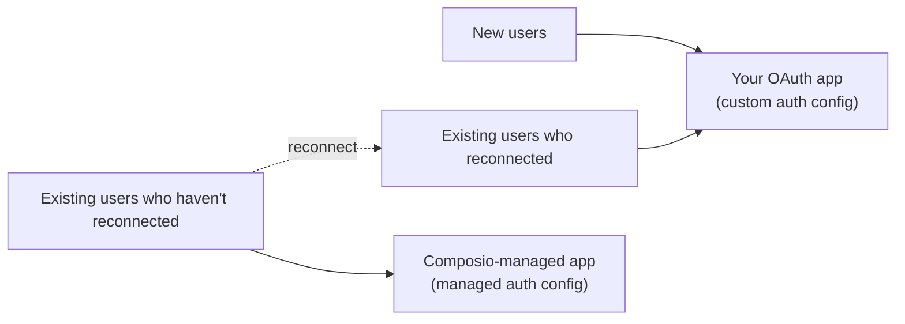

This guide is for apps that already have users connected through a [Composio-managed app](/toolkits/managed-auth) and want to switch a toolkit to their own OAuth app. To decide whether you need to, read [Managed vs custom auth](/docs/authentication/custom-app-vs-managed-app).

You move one toolkit at a time. Each toolkit gets its own auth config, so Gmail can move while Slack stays on the managed app.

## What carries over

- **Your user IDs, sessions, and agent code.** Only the auth config a session uses for the toolkit changes.
- **Existing connected accounts.** They keep working and refreshing on the managed auth config until you disable or delete them.
- **Token custody.** Composio still stores and refreshes tokens for connections on your own app. See [OAuth app ownership and token custody](/docs/security/token-custody#oauth-app-ownership-and-token-custody).

## What doesn't carry over

Existing users must reconnect. A provider issues OAuth tokens to a specific client ID, so tokens granted to Composio's app only work with Composio's app. Your app can't refresh or reuse them.

You also can't export managed tokens and import them under your new config. Connected-account API responses [redact credential fields](/docs/auth-configuration/connected-accounts#credential-masking), and reading account state isn't a supported token-export path. [Importing existing connections](/docs/authentication/importing-existing-connections) only covers credentials your application already holds.

Trigger instances belong to a connected account, so each reconnected user needs new triggers too.

## How the move works

Run both configs side by side. New users and users who have reconnected use your app. Everyone else stays on the managed app until they reconnect.



## Migrating

<Steps>
<Step>
<StepTitle>Register your OAuth app with the provider</StepTitle>

Create an OAuth app in the provider's developer portal. Set its name, logo, support details, and the scopes your product needs. Step-by-step guides: [Google](https://composio.dev/auth/googleapps) | [GitHub](https://composio.dev/auth/github) | [Slack](https://composio.dev/auth/slack) | [HubSpot](https://composio.dev/auth/hubspot) | [All toolkits](https://composio.dev/auth)

You add the redirect URI in the next step, once Composio shows it to you.

<Callout type="warn" title="Start provider verification early">
Some providers review apps before real users can authorize them. Google, for example, requires verification for sensitive and restricted scopes, and that review can take weeks. Submit your app before you plan to switch, and keep users on the managed app until the provider approves it.
</Callout>
</Step>

<Step>
<StepTitle>Create a custom auth config</StepTitle>

In the [dashboard's auth configs](https://dashboard.composio.dev/~/project/auth-configs?utm_source=docs&utm_medium=content&utm_campaign=docs-managed-to-own-app), click **Create** and select the toolkit. Choose **OAuth2**, enable **Use your own developer credentials**, and enter your app's client ID, client secret, and scopes.

Copy the **Redirect URI** from the form into your provider app's list of authorized redirect URIs. The two values must match exactly. See [Using your own OAuth apps](/docs/authentication/white-labeling-authentication#using-your-own-oauth-apps) for which callback URL to use.

<Figure src="/images/own-oauth-app-auth-config-form.png" alt="The credentials section of the Gmail auth config form, with fields for client ID, client secret, redirect URI, and scopes" caption="Enter your app's credentials, copy the redirect URI to the provider, and choose scopes" size="sm" />

Click **Create Auth Config** and copy the new `ac_...` ID. Also note the ID of the managed auth config your existing users connected through. The dashboard marks it as **Managed**.

To create the config in code instead, see [Programmatic auth configs](/docs/authentication/programmatic-auth-configs#your-own-oauth2-credentials).
</Step>

<Step>
<StepTitle>Send new connections to your app</StepTitle>

A session uses a custom auth config only when you pass it in `auth_configs` (Python) or `authConfigs` (TypeScript), keyed by toolkit. The session then finds or creates the user's connection on that config. See [Precedence](/docs/configuring-sessions#precedence).

That means a session pointed at your app asks an existing user to connect again. Make this change once the provider has approved your app. To keep existing users working, choose the config per user: your app for anyone with an active connection on it or no managed connection at all, and the managed config for everyone else.

<Tabs groupId="language" items={['Python', 'TypeScript', 'API']} persist>
<Tab value="Python">
```python
from composio import Composio

composio = Composio()

OWN_APP_CONFIG = "ac_your_own_gmail_config"
MANAGED_CONFIG = "ac_your_managed_gmail_config"


def has_active_connection(user_id: str, auth_config_id: str) -> bool:
    accounts = composio.connected_accounts.list(
        user_ids=[user_id],
        auth_config_ids=[auth_config_id],
        statuses=["ACTIVE"],
    )
    return len(accounts.items) > 0


def gmail_auth_config_for(user_id: str) -> str:
    if has_active_connection(user_id, OWN_APP_CONFIG):
        return OWN_APP_CONFIG
    if has_active_connection(user_id, MANAGED_CONFIG):
        return MANAGED_CONFIG
    return OWN_APP_CONFIG


session = composio.create(
    user_id="user_123",
    auth_configs={"gmail": gmail_auth_config_for("user_123")},
)
```
</Tab>
<Tab value="TypeScript">
```typescript
import { Composio } from '@composio/core';

const composio = new Composio();

const OWN_APP_CONFIG = 'ac_your_own_gmail_config';
const MANAGED_CONFIG = 'ac_your_managed_gmail_config';

async function hasActiveConnection(userId: string, authConfigId: string): Promise<boolean> {
  const accounts = await composio.connectedAccounts.list({
    userIds: [userId],
    authConfigIds: [authConfigId],
    statuses: ['ACTIVE'],
  });
  return accounts.items.length > 0;
}

async function gmailAuthConfigFor(userId: string): Promise<string> {
  if (await hasActiveConnection(userId, OWN_APP_CONFIG)) return OWN_APP_CONFIG;
  if (await hasActiveConnection(userId, MANAGED_CONFIG)) return MANAGED_CONFIG;
  return OWN_APP_CONFIG;
}

const session = await composio.create('user_123', {
  authConfigs: { gmail: await gmailAuthConfigFor('user_123') },
});
```
</Tab>
<Tab value="API">
```bash
OWN_APP_CONFIG="ac_your_own_gmail_config"
MANAGED_CONFIG="ac_your_managed_gmail_config"

# Count the user's active connections on each config
ON_OWN_APP=$(curl -s "https://backend.composio.dev/api/v3.1/connected_accounts?user_ids=user_123&auth_config_ids=$OWN_APP_CONFIG&statuses=ACTIVE" \
  -H "x-api-key: $COMPOSIO_API_KEY" | jq '.items | length')
ON_MANAGED=$(curl -s "https://backend.composio.dev/api/v3.1/connected_accounts?user_ids=user_123&auth_config_ids=$MANAGED_CONFIG&statuses=ACTIVE" \
  -H "x-api-key: $COMPOSIO_API_KEY" | jq '.items | length')

GMAIL_CONFIG=$OWN_APP_CONFIG
if [ "$ON_OWN_APP" -eq 0 ] && [ "$ON_MANAGED" -gt 0 ]; then
  GMAIL_CONFIG=$MANAGED_CONFIG
fi

curl -X POST https://backend.composio.dev/api/v3.1/tool_router/session \
  -H "x-api-key: $COMPOSIO_API_KEY" \
  -H "Content-Type: application/json" \
  -d "{\"user_id\": \"user_123\", \"auth_configs\": {\"gmail\": \"$GMAIL_CONFIG\"}}"
```
</Tab>
</Tabs>

Toolkits you leave out of `auth_configs` keep their current behavior. Store which config each user is on in your own database if you'd rather not look it up on every session.
</Step>

<Step>
<StepTitle>Reconnect existing users</StepTitle>

Ask each existing user to connect again, for example with an in-app banner or at their next sign-in. Generate a Connect Link on your new config:

<Tabs groupId="language" items={['Python', 'TypeScript', 'API']} persist>
<Tab value="Python">
```python
from composio import Composio

composio = Composio()
request = composio.connected_accounts.link(
    user_id="user_123",
    auth_config_id="ac_your_own_gmail_config",
    callback_url="https://your-app.com/connections/callback",
)
```
</Tab>
<Tab value="TypeScript">
```typescript
import { Composio } from '@composio/core';

const composio = new Composio();
const request = await composio.connectedAccounts.link(
  'user_123',
  'ac_your_own_gmail_config',
  { callbackUrl: 'https://your-app.com/connections/callback' },
);
```
</Tab>
<Tab value="API">
```bash
curl --request POST \
  --url https://backend.composio.dev/api/v3.1/connected_accounts/link \
  --header "x-api-key: $COMPOSIO_API_KEY" \
  --header "Content-Type: application/json" \
  --data '{
    "auth_config_id": "ac_your_own_gmail_config",
    "user_id": "user_123",
    "callback_url": "https://your-app.com/connections/callback"
  }' | jq '{connected_account_id, redirect_url}'
```
</Tab>
</Tabs>

Send the browser to the returned redirect URL. The user now sees your app's name on the provider's consent screen. Once the new connection is `ACTIVE`, the routing from the previous step sends that user's sessions to your app.

Use the same user ID the managed connection has. A different user ID creates a connection that your sessions and triggers won't match to the existing user.
</Step>

<Step>
<StepTitle>Recreate triggers on the new connection</StepTitle>

Triggers stay attached to the managed connected account. List them, create the same trigger type and config on the new connected account, then disable the old instance:

<Tabs groupId="language" items={['Python', 'TypeScript', 'API']} persist>
<Tab value="Python">
```python
from composio import Composio

composio = Composio()

old_triggers = composio.triggers.list_active(
    connected_account_ids=["ca_old_managed_account"],
)

for trigger in old_triggers.items:
    composio.triggers.create(
        slug=trigger.trigger_name,
        connected_account_id="ca_new_own_app_account",
        trigger_config=trigger.trigger_config,
    )
    composio.triggers.disable(trigger_id=trigger.id)
```
</Tab>
<Tab value="TypeScript">
```typescript
import { Composio } from '@composio/core';

const composio = new Composio();

const oldTriggers = await composio.triggers.listActive({
  connectedAccountIds: ['ca_old_managed_account'],
});

for (const trigger of oldTriggers.items) {
  await composio.triggers.create('user_123', trigger.triggerName, {
    connectedAccountId: 'ca_new_own_app_account',
    triggerConfig: trigger.triggerConfig,
  });
  await composio.triggers.disable(trigger.id);
}
```
</Tab>
<Tab value="API">
```bash
# List triggers on the managed connection
curl -s "https://backend.composio.dev/api/v3.1/trigger_instances/active?connected_account_ids=ca_old_managed_account" \
  -H "x-api-key: $COMPOSIO_API_KEY" | jq '.items[] | {id, trigger_name, trigger_config}'

# For each one, create the same trigger type on the new connection.
# Use its trigger_name in the URL and copy its trigger_config into the body.
curl -X POST https://backend.composio.dev/api/v3.1/trigger_instances/GMAIL_NEW_GMAIL_MESSAGE/upsert \
  -H "x-api-key: $COMPOSIO_API_KEY" \
  -H "Content-Type: application/json" \
  -d '{"user_id": "user_123", "connected_account_id": "ca_new_own_app_account", "trigger_config": {}}'

# Then disable the old instance
curl -X PATCH https://backend.composio.dev/api/v3.1/trigger_instances/manage/ti_old_trigger \
  -H "x-api-key: $COMPOSIO_API_KEY" \
  -H "Content-Type: application/json" \
  -d '{"status": "disable"}'
```
</Tab>
</Tabs>

Results are cursor-paginated. If the list returns a next cursor, fetch the next page as shown in [Listing active triggers](/docs/setting-up-triggers/managing-triggers#listing-active-triggers). Polling triggers on your own app can use shorter intervals than the managed minimum where the toolkit supports it.

Disable the old trigger rather than deleting it until you've confirmed events arrive from the new one. Otherwise both instances fire for the same event while they overlap.
</Step>

<Step>
<StepTitle>Retire the managed connections</StepTitle>

After a user's new connection works, [disable](/docs/auth-configuration/connected-accounts#enable-and-disable-accounts) their managed connected account. Disabling an account also disables its triggers, and you can re-enable it if something goes wrong. Once you're confident, [delete the old triggers](/docs/setting-up-triggers/managing-triggers#deleting-triggers) and [delete the managed connected account](/docs/auth-configuration/connected-accounts#delete-accounts). Deletion is permanent.

To revoke the upstream token as well, use [Revoke accounts](/docs/auth-configuration/connected-accounts#revoke-accounts) where the toolkit supports it.

When no active connections remain on the managed config, every user is on your app. You can then pass your config in every session and drop the routing logic.
</Step>
</Steps>

## Checklist

1. Your OAuth app is registered, and the provider has approved it for the scopes you need.
2. The provider's authorized redirect URI matches the one in your custom auth config.
3. Sessions route each user to the right config, and new users land on your app.
4. Existing users have a way to reconnect, under the same user ID.
5. Triggers exist on each new connection, and the old ones are disabled.
6. Managed connected accounts are disabled or deleted once their replacements work.
7. A connected-account list filtered to the managed config shows no active accounts.

## Next

<Cards>
  <Card icon={<Key />} title="Managed vs custom auth" href="/docs/authentication/custom-app-vs-managed-app" description="What a managed app limits and when to move" />
  <Card icon={<Palette />} title="White-labeling authentication" href="/docs/authentication/white-labeling-authentication" description="Brand the Connect Link and configure callback URLs" />
</Cards>
