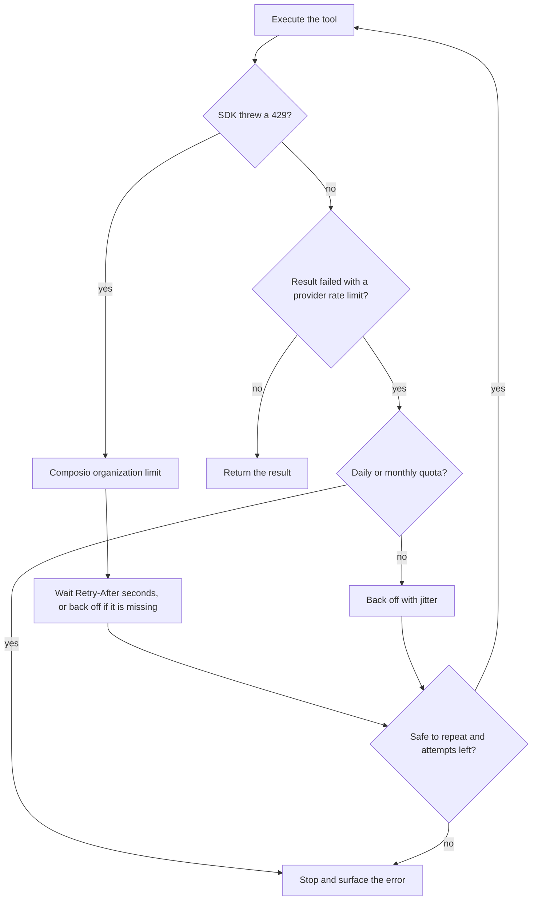

A rate limit can come from Composio or from the app a tool calls. The two look different in your code and need different fixes. This guide shows how to tell them apart, retry the ones that clear on their own, and send traffic in a shape that hits fewer limits in the first place.

For the limits themselves, the response headers, and the 429 body, see [Rate limits](/reference/rate-limits).

## Know which limit you hit

| Limit | How it reaches your code | Retry? |
| --- | --- | --- |
| Composio API rate limit | The SDK call throws on an HTTP `429`, with a `Retry-After` header | Yes, after `Retry-After` |
| Composio plan usage | Check your Composio usage and billing | No. Waiting a few seconds does not reset it |
| Provider quota, short window | The call succeeds, but the tool result fails with the provider's error, such as a `429` or `rateLimitExceeded` | Yes, with backoff |
| Provider quota, daily or monthly | The tool result fails with the provider's error, which names a daily or monthly quota | No. Wait for the reset or get more quota |

Only the first row raises an exception in the SDK. For a provider limit, the request to Composio succeeds and the provider's rejection comes back inside the tool result, so check both places.

<Tabs groupId="language" items={['Python', 'TypeScript', 'API']} persist>
<Tab value="Python">
```python
from composio import Composio
from composio_client import RateLimitError

composio = Composio()
session = composio.create(user_id="user_123")

try:
    result = session.execute("GMAIL_FETCH_EMAILS", arguments={"max_results": 10})
except RateLimitError as error:
    # Composio's organization limit. The request was not run.
    print("Composio 429, retry after", error.response.headers.get("retry-after"))
else:
    if result.result_type == "failed":
        # The tool ran and failed. A provider quota error lands here.
        print("Tool failed:", result.error)
```
</Tab>
<Tab value="TypeScript">
```typescript
import { Composio } from '@composio/core';
const composio = new Composio({ apiKey: 'your_api_key' });
// ---cut---
const session = await composio.create('user_123');

try {
  const result = await session.execute('GMAIL_FETCH_EMAILS', { max_results: 10 });
  if (result.resultType === 'failed') {
    // The tool ran and failed. A provider quota error lands here.
    console.log('Tool failed:', result.error);
  }
} catch (error) {
  // session.execute() rethrows the API client's error, which carries the HTTP status.
  if (error instanceof Error && 'status' in error && error.status === 429) {
    console.log("Composio 429: Composio's organization limit");
  }
  throw error;
}
```
</Tab>
<Tab value="API">
```bash
# SESSION_ID is the session_id returned when you created the session.
# -D - prints the response headers, including X-RateLimit-Remaining and, on a 429, Retry-After.
curl -sS -D - -X POST https://backend.composio.dev/api/v3.1/tool_router/session/$SESSION_ID/execute \
  -H "x-api-key: $COMPOSIO_API_KEY" \
  -H "Content-Type: application/json" \
  -d '{
    "tool_slug": "GMAIL_FETCH_EMAILS",
    "arguments": { "max_results": 10 }
  }'
```
</Tab>
</Tabs>

A provider error is free text from the provider. Match it against the names your providers use, such as `RESOURCE_EXHAUSTED`, `rateLimitExceeded`, `userRateLimitExceeded`, or `ThrottleExceeded`, and read the provider's documentation for which ones are daily quotas. The [provider quota errors](/reference/rate-limits#provider-quota-errors) table lists a few.

If you call `composio.tools.execute()` in TypeScript, a Composio 429 throws `ComposioToolExecutionRateLimitError`, and a 429 while fetching the tool's schema throws `ComposioToolFetchRateLimitError`. Both have a `retryAfterSeconds` field when the response gave one, and `isComposioRateLimitError()` matches either. See [What the SDK already does](#what-the-sdk-already-does).

## Retry the limits that clear

The SDKs send every tool execution exactly once. They do not retry `session.execute()`, `tools.execute()`, or proxy calls, because a retry after a timeout could repeat a side effect such as sending an email twice. See [Retry failed executions deliberately](/docs/production-readiness#retry-failed-executions-deliberately). Retrying an execution is your decision, so make it carefully:

1. Honor `Retry-After` on a Composio 429. It tells you when the window resets.
2. For a short provider limit, back off exponentially with random jitter, so many workers don't retry at the same moment. Cap the delay and the number of attempts.
3. Don't retry an exhausted daily or monthly quota. Each retry spends a request and the quota stays empty.
4. Retry a write only when repeating it is safe.



<Tabs groupId="language" items={['Python', 'TypeScript', 'API']} persist>
<Tab value="Python">
```python
import random
import time

from composio import Composio
from composio_client import RateLimitError

composio = Composio()
session = composio.create(user_id="user_123")

MAX_ATTEMPTS = 5
BASE_DELAY_SECONDS = 1.0
MAX_DELAY_SECONDS = 30.0

# Adjust these to the error text your providers return.
PROVIDER_LIMIT_MARKERS = ("429", "rate limit", "ratelimitexceeded", "resource_exhausted", "throttle")
EXHAUSTED_QUOTA_MARKERS = ("daily", "per day", "dailylimitexceeded", "monthly")


def backoff_seconds(attempt: int) -> float:
    """Exponential backoff with full jitter: a random wait up to the capped exponential delay."""
    return random.uniform(0, min(MAX_DELAY_SECONDS, BASE_DELAY_SECONDS * 2**attempt))


def retry_after_seconds(error: RateLimitError, attempt: int) -> float:
    value = error.response.headers.get("retry-after", "")
    try:
        return max(0.0, float(value))
    except ValueError:
        # Missing, or an HTTP date: fall back to backoff.
        return backoff_seconds(attempt)


def execute_with_retry(tool_slug: str, arguments: dict, *, safe_to_repeat: bool):
    for attempt in range(MAX_ATTEMPTS):
        last_attempt = attempt == MAX_ATTEMPTS - 1
        try:
            result = session.execute(tool_slug, arguments=arguments)
        except RateLimitError as error:
            # Composio's organization limit.
            if last_attempt or not safe_to_repeat:
                raise
            time.sleep(retry_after_seconds(error, attempt))
            continue

        error_text = (result.error or "").lower()
        provider_limited = result.result_type == "failed" and any(
            marker in error_text for marker in PROVIDER_LIMIT_MARKERS
        )
        if not provider_limited:
            return result
        if any(marker in error_text for marker in EXHAUSTED_QUOTA_MARKERS):
            return result  # The quota is gone until it resets. Don't spend more requests.
        if last_attempt or not safe_to_repeat:
            return result
        time.sleep(backoff_seconds(attempt))
    raise RuntimeError("unreachable")


emails = execute_with_retry(
    "GMAIL_FETCH_EMAILS", {"max_results": 10}, safe_to_repeat=True
)
```
</Tab>
<Tab value="TypeScript">
```typescript
import { Composio, isComposioRateLimitError } from '@composio/core';
const composio = new Composio({ apiKey: 'your_api_key' });
// ---cut---
const session = await composio.create('user_123');

const MAX_ATTEMPTS = 5;
const BASE_DELAY_MS = 1_000;
const MAX_DELAY_MS = 30_000;

// Adjust these to the error text your providers return.
const PROVIDER_LIMIT_MARKERS = ['429', 'rate limit', 'ratelimitexceeded', 'resource_exhausted', 'throttle'];
const EXHAUSTED_QUOTA_MARKERS = ['daily', 'per day', 'dailylimitexceeded', 'monthly'];

const sleep = (ms: number) => new Promise(resolve => setTimeout(resolve, ms));

/** Exponential backoff with full jitter: a random wait up to the capped exponential delay. */
function backoffMs(attempt: number): number {
  return Math.random() * Math.min(MAX_DELAY_MS, BASE_DELAY_MS * 2 ** attempt);
}

/** How long to wait after a Composio 429, or null when the error is something else. */
function composioRateLimitWaitMs(error: unknown, attempt: number): number | null {
  // Direct tool execution throws a typed rate-limit error.
  if (isComposioRateLimitError(error)) {
    return error.retryAfterSeconds !== undefined ? error.retryAfterSeconds * 1_000 : backoffMs(attempt);
  }
  // session.execute() rethrows the API client's error, with the status and headers.
  if (error instanceof Error && 'status' in error && error.status === 429) {
    const header =
      'headers' in error && error.headers instanceof Headers ? error.headers.get('retry-after') : null;
    const seconds = header === null ? NaN : Number(header);
    return Number.isFinite(seconds) && seconds >= 0 ? seconds * 1_000 : backoffMs(attempt);
  }
  return null;
}

async function executeWithRetry(
  toolSlug: string,
  args: Record<string, unknown>,
  { safeToRepeat }: { safeToRepeat: boolean }
) {
  for (let attempt = 0; ; attempt++) {
    const lastAttempt = attempt === MAX_ATTEMPTS - 1;
    let result;
    try {
      result = await session.execute(toolSlug, args);
    } catch (error) {
      const waitMs = composioRateLimitWaitMs(error, attempt);
      if (waitMs === null || lastAttempt || !safeToRepeat) throw error;
      await sleep(waitMs);
      continue;
    }

    const errorText = (result.error ?? '').toLowerCase();
    const providerLimited =
      result.resultType === 'failed' && PROVIDER_LIMIT_MARKERS.some(m => errorText.includes(m));
    if (!providerLimited) return result;
    // An exhausted quota stays empty until it resets. Don't spend more requests.
    if (EXHAUSTED_QUOTA_MARKERS.some(m => errorText.includes(m))) return result;
    if (lastAttempt || !safeToRepeat) return result;
    await sleep(backoffMs(attempt));
  }
}

const emails = await executeWithRetry('GMAIL_FETCH_EMAILS', { max_results: 10 }, { safeToRepeat: true });
```
</Tab>
<Tab value="API">
```bash
# Retry the same execute request after the number of seconds in Retry-After.
RESPONSE_HEADERS=$(mktemp)
for attempt in 1 2 3 4 5; do
  STATUS=$(curl -sS -o response.json -D "$RESPONSE_HEADERS" -w '%{http_code}' \
    -X POST https://backend.composio.dev/api/v3.1/tool_router/session/$SESSION_ID/execute \
    -H "x-api-key: $COMPOSIO_API_KEY" \
    -H "Content-Type: application/json" \
    -d '{"tool_slug": "GMAIL_FETCH_EMAILS", "arguments": {"max_results": 10}}')
  [ "$STATUS" != "429" ] && break
  WAIT=$(grep -i '^retry-after:' "$RESPONSE_HEADERS" | tr -dc '0-9')
  sleep "${WAIT:-$((2 ** attempt))}"
done
cat response.json
```
</Tab>
</Tabs>

### Make retried writes safe

A read such as `GMAIL_FETCH_EMAILS` is safe to repeat. A write such as `GMAIL_SEND_EMAIL` is not. If the first attempt reached the provider, a retry sends the email again.

Before you retry a write, check whether the first attempt landed. Look for the record it would have created, such as the sent message, the issue, or the calendar event, through a read tool or the provider's API. You can also check the call in [Logs](/reference/api-reference/logs). Resend only when the record is missing. If the provider's API accepts an idempotency key or a client-generated ID, pass one so a repeat is ignored.

## What the SDK already does

The SDKs handle part of this for you. Don't add a second layer of retries on top of these.

| Behavior | Python | TypeScript |
| --- | --- | --- |
| Retries reads (fetching tools, listing toolkits, reading a session) on timeouts, `408`, `409`, `429`, and `5xx` | Yes | Yes |
| Retries tool executions and proxy calls | No | No |
| Reuses a tool's schema across executions | `tools.execute()` fetches each tool's schema once per `Tools` instance | `tools.execute()` reuses a schema for 5 minutes on `latest` and 1 hour on a pinned version, up to 500 entries per `Tools` instance. Failed fetches aren't cached |
| Typed error for a Composio 429 | `composio_client.RateLimitError`, with the response headers on `error.response.headers` | `ComposioToolFetchRateLimitError` and `ComposioToolExecutionRateLimitError` from `tools.execute()`, with `retryAfterSeconds`. `isComposioRateLimitError()` matches both. `session.execute()` rethrows the API client's error with `status` `429` |
| Connection polling | `wait_for_connection()` waits 1 second between polls at first, growing to 5 seconds, and keeps polling through a 429 | `waitForConnection()` behaves the same way |

When a poll inside `wait_for_connection()` or `waitForConnection()` is rate limited, the method waits as long as the response asks and polls again. The client's own retries are not bound by your timeout, so a rate-limited wait can run past it. See [Waiting for connection establishment](/docs/tools-direct/authenticating-tools#waiting-for-connection-establishment).

## Shape your traffic

Most rate limits are easier to avoid than to recover from.

### Cap concurrency per connected account

Providers often meter each user or account separately. Gmail, for example, has a per-user quota on top of the per-project one. See Google's [Gmail API usage limits](https://developers.google.com/workspace/gmail/api/reference/quota). Ten agents working for one user all draw from that user's quota, even when your Composio limit has room.

Queue tool calls per user ID or connected account, and run only a few at a time for each one.

<Tabs groupId="language" items={['Python', 'TypeScript', 'API']} persist>
<Tab value="Python">
```python
import threading
from collections import defaultdict

from composio import Composio

composio = Composio()

MAX_CALLS_PER_USER = 2
_user_slots: defaultdict[str, threading.BoundedSemaphore] = defaultdict(
    lambda: threading.BoundedSemaphore(MAX_CALLS_PER_USER)
)
_slots_lock = threading.Lock()


def execute_for_user(user_id: str, tool_slug: str, arguments: dict):
    with _slots_lock:
        slots = _user_slots[user_id]
    with slots:  # Blocks while this user already has MAX_CALLS_PER_USER calls running.
        session = composio.create(user_id=user_id)
        return session.execute(tool_slug, arguments=arguments)
```
</Tab>
<Tab value="TypeScript">
```typescript
import { Composio } from '@composio/core';
const composio = new Composio({ apiKey: 'your_api_key' });
// ---cut---
const MAX_CALLS_PER_USER = 2;
const running = new Map<string, number>();
const waiting = new Map<string, Array<() => void>>();

async function acquire(userId: string): Promise<void> {
  if ((running.get(userId) ?? 0) < MAX_CALLS_PER_USER) {
    running.set(userId, (running.get(userId) ?? 0) + 1);
    return;
  }
  // Wait for a running call to hand over its slot.
  await new Promise<void>(resolve => {
    const queue = waiting.get(userId) ?? [];
    queue.push(resolve);
    waiting.set(userId, queue);
  });
}

function release(userId: string): void {
  const next = waiting.get(userId)?.shift();
  if (next) {
    next(); // Hand the slot straight to the next queued call.
  } else {
    running.set(userId, (running.get(userId) ?? 1) - 1);
  }
}

async function executeForUser(userId: string, toolSlug: string, args: Record<string, unknown>) {
  await acquire(userId);
  try {
    const session = await composio.create(userId);
    return await session.execute(toolSlug, args);
  } finally {
    release(userId);
  }
}
```
</Tab>
<Tab value="API">
```bash
# Run calls for one user one after another rather than in parallel.
for tool_slug in GMAIL_FETCH_EMAILS GMAIL_LIST_LABELS; do
  curl -sS -X POST https://backend.composio.dev/api/v3.1/tool_router/session/$SESSION_ID/execute \
    -H "x-api-key: $COMPOSIO_API_KEY" \
    -H "Content-Type: application/json" \
    -d "{\"tool_slug\": \"$tool_slug\", \"arguments\": {}}"
done
```
</Tab>
</Tabs>

These examples create a session per call to stay short. In a real agent, create the session once per user and reuse it, as the next section describes.

### Spend fewer calls

- **Page in small steps and stop early.** Ask a list tool for a small page and stop paginating once you have what the task needs. Listing a whole mailbox or repository to find a few items burns quota on pages you never read.
- **Use triggers instead of polling.** Calling a tool in a loop to check for new messages spends quota on empty answers. A [trigger](/docs/triggers) sends you an event when something changes.
- **Reuse sessions and cache static data.** Persist a session ID for multi-turn work instead of creating a session on every turn. Keep tool definitions and other data that rarely changes in your process.
- **Watch `X-RateLimit-Remaining`.** It shows the requests left in the current Composio window. Slow down background work before it reaches zero, so interactive requests still have room.

## When you outgrow a Composio-managed app

With Composio-managed auth, some provider quotas are shared across every connection that uses Composio's OAuth app. If you keep hitting a provider quota that backoff and traffic shaping don't fix, move to your own OAuth app. Your connections then draw from your own provider quota, and you can request a higher one from the provider.

See [Managed vs custom auth](/docs/authentication/custom-app-vs-managed-app). Existing connections stay on the managed app, so your users reconnect under the new auth config.

## Related

<Cards>
  <Card title="Rate limits" href="/reference/rate-limits" description="Composio's limits, headers, 429 response, and provider quota errors." />
  <Card title="Production readiness" href="/docs/production-readiness" description="Retry, logging, and testing decisions before launch." />
  <Card title="Triggers" href="/docs/triggers" description="Receive events instead of polling with tool calls." />
</Cards>
