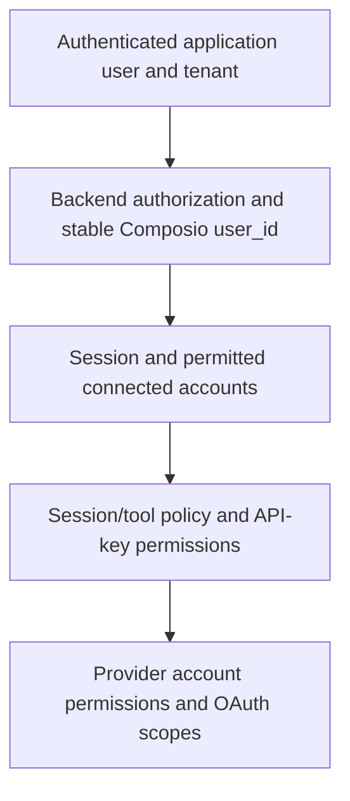

Delegated authorization lets your agent act through a connected provider account within the access your application permits. In Composio, that access spans several boundaries: your application's identity checks, session restrictions, API-key permissions, and the provider's own grants.

A `user_id` associates resources with an application identity. It does not authenticate that identity. A tool allowlist constrains a particular execution path. It does not reduce the provider token's scopes or constrain every other route that can use the account.

For credential storage and injection, see [Token custody architecture](/docs/security/token-custody). This guide covers who may act, on which account, through which paths.

## Start with a restricted session

Run this in a trusted backend shell with cURL and `COMPOSIO_API_KEY` set to your project key. A scoped key needs **Session management** write access to create the session. Execution separately needs **Session tool execution** write access.

```bash
: "${COMPOSIO_API_KEY:?Set your Composio project API key}"

curl --fail-with-body --silent --show-error \
  -X POST https://backend.composio.dev/api/v3.1/tool_router/session \
  -H "x-api-key: ${COMPOSIO_API_KEY}" \
  -H "Content-Type: application/json" \
  -d '{
    "user_id": "org_42:user_7",
    "toolkits": {"enable": ["gmail"]},
    "tools": {"gmail": {"enable": ["GMAIL_FETCH_EMAILS"]}},
    "manage_connections": {"enable": false},
    "workbench": {"enable": false},
    "proxy_execute": {"enable": false},
    "instant": false
  }'
```

The [create-session API](/reference/api-reference/tool-router/postToolRouterSession) returns a `session_id` and its configuration. The request allows one Gmail tool, disables agent-initiated connections, disables the sandbox and proxy execution, and disables Instant-account usage. It creates a session, not a provider connection or a new OAuth grant.

The example identity is illustrative. In your backend, derive `user_id` from your verified application session, not from an untrusted request field. To execute the Gmail tool, first [connect Gmail](/docs/authentication/manually-authenticating) for that same identity. If account choice matters, pin the intended account as described below.

<Callout type="warn" title="Omitting restrictions widens access">
Sessions allow every toolkit by default. Use explicit allowlists for narrow agents. `{ "enable": [] }` denies all app toolkits; omitting `toolkits` does not. Meta tools have separate controls. See [Configuring sessions](/docs/configuring-sessions#denying-every-app-toolkit).
</Callout>

## Bind your application identity on the backend

The identity chain is:



Use your existing identity provider (IdP) to authenticate the application request. Your backend validates that login and tenant membership, then maps the verified subject to an opaque, stable `user_id`. Passing that string to Composio is resource association, not built-in IdP federation, JWT validation, or proof of login.

Keep the mapping in your application database alongside the Composio project, session, and connected-account IDs. For example, `org_42:user_7` distinguishes members whose local IDs might otherwise collide between tenants. Avoid emails and names because `user_id` is retained in execution metadata, including with ZDR.

Before creating, restoring, or using a session:

1. Authenticate the request and resolve the current tenant on your backend.
2. Check the member's current role and permission to act through the requested connection.
3. Resolve the allowed project, `user_id`, session, and account IDs from your own records.
4. Apply the intended session policy and invoke only the execution paths that policy covers.

Do not accept a browser-supplied `user_id`, session ID, account ID, or auth-config ID as authorization. Keep project API keys server-side. An identifier can select a resource without proving that your application caller may use it.

If you configure a project OAuth callback verifier, [deferred OAuth completion](/docs/auth-configuration/connected-accounts#complete-deferred-oauth) lets your backend verify identity before redeeming the single-use session URI with the expected `user_id`. This is a connection-time check, not a replacement for request-time application authorization.

## Separate the authorization layers

| Layer | What it controls | What it does not establish |
| --- | --- | --- |
| Application identity and policy | Which signed-in member may act for a tenant, account, resource, or operation | Composio does not learn your membership or business rules from `user_id` alone. |
| Provider grant | OAuth scopes and the provider account's own permissions | One scope can authorize many operations. A scope is not necessarily a per-tool grant. |
| Session toolkit, tool, and tag rules | Which app tools are available and executable through that session | These rules do not narrow an existing token or become a project-wide policy. |
| Project API-key permissions | Which API permission areas the key may use | A scoped key is not an end-user login or a per-tool, per-tenant role assignment. |
| Model tool list | Which definitions you supply to the model | Hiding a definition alone does not deny execution through another route. |

Choose [provider scopes](/docs/authentication/controlling-scopes) for the minimum upstream access required. Configure them on the auth config used for connection. Updating an auth config's scopes does not change existing grants; existing accounts need to reconnect. API-key-authenticated providers use their own credential permissions rather than OAuth scopes.

Use explicit tool slugs when you need a precise session allowlist. Tag filters such as `readOnlyHint` and `destructiveHint` rely on best-effort tool classification, not a provider-level guarantee about side effects. Per-toolkit tag rules replace session-wide tag rules for that toolkit, so review overrides as complete policies.

Use [scoped project API keys](/reference/authenticating-to-composio/project-api-key-permissions) to separate session administration, execution, account management, and observability. Default project keys retain full access. Restrict **Session management** write access because a caller that can change or create sessions can change their access policy.

## Bind the intended account and tenant

Sessions resolve connected accounts by `user_id`. To avoid relying on automatic account selection, pass `connected_accounts` keyed by toolkit when creating the session. The REST API accepts an array of account IDs per toolkit, for example `"connected_accounts": {"gmail": ["ca_your_work_account"]}`.

Each pinned account must exist and must not be deleted or disabled. A private account must belong to the session's `user_id`; a shared account may belong to another user if its access rules permit the session's user to use it. See [Shared connections](/docs/extending-sessions/shared-connections). Non-multi-account sessions accept at most one pinned account per toolkit. With multi-account mode, use `require_explicit_selection` when the caller must select an account rather than accept a default. See [Managing multiple connected accounts](/docs/authentication/managing-multiple-connected-accounts).

Account selection and application authorization remain different checks. Your backend must verify that the member may use the pinned account. A human-readable alias helps selection; it is not proof of ownership or permission.

For a [B2B agent](/docs/b2b-agents), decide whether connections belong to a member or a workspace:

- **Member-owned:** use a distinct tenant-and-member identity. Do not put every member's private accounts under one shared `user_id`.
- **Workspace-owned:** use an explicit integration identity, then enforce which members may invoke it. Record the initiating member separately because all calls share the integration's `user_id`.
- **Shared connections:** review the explicit grants in [shared connections](/docs/extending-sessions/shared-connections). This experimental feature extends access beyond private account matching and must be included in your isolation review.

Projects separate resources and API keys. A single project can contain multiple application tenants, but your backend owns the tenant-to-identity mapping and authorization checks. Use separate projects where you need independent keys, configuration, administration, or contractual boundaries. A tenant prefix in `user_id` does not itself create that project boundary.

## Check every execution path

A policy is effective only on the paths that enforce it. Inventory the ways your agent, backend, workers, and MCP clients can execute actions.

| Execution path | Applicable boundary and review |
| --- | --- |
| Native app tools through a session, including session-linked MCP | Session toolkit, tool, and tag filters constrain app tool access. Apply the policy on the session, not only to the list sent to the model. |
| Session Proxy Execute | Toolkit allowlists and denylists apply. Individual tool and hint filters do not, because the request names an HTTP endpoint rather than a tool. |
| Sandbox / Workbench helpers | Tool and proxy helpers are separate paths. Proxy access can reach provider operations outside per-tool filters. Disable the sandbox when you do not need code execution. |
| Direct `composio.tools.execute()` | Executes outside a session using the direct execution API. Do not expect another session's policy to apply. Restrict the **Tool execution (Legacy)** key permission and enforce your backend policy. |
| Direct `composio.tools.proxyExecute()` / Python `composio.tools.proxy()` | Uses an account ID outside a session. Do not expect session toolkit, tool, or approval rules to apply. Restrict **Proxy execute (Legacy)** and validate account and endpoint access. |
| Legacy MCP server `allowedTools` / `allowed_tools` | Configures that MCP server's tool set. It is not an account-wide or project-wide authorization policy and does not restrict direct execution or proxy routes. |
| Local custom tools and independent provider clients | Your code enforces access to its own side effects and credentials. A Composio session policy is not a universal interceptor for application code. |

Fetching a limited list with `composio.tools.get()`, removing model definitions, or preloading a subset of tools changes exposure. It does not turn those lists into a global execution allowlist. The direct-tools *session preset* is different from direct execution: it still uses a session and its filters.

For a tool-only worker, grant **Session tool execution**, but not direct **Tool execution (Legacy)** or **Proxy execute (Legacy)**. Session proxy execution also requires the Proxy execute permission; Session tool execution alone does not authorize it. Keep session creation and policy updates in a separately trusted component if the worker must not widen its own access.

Disable unused raw HTTP paths explicitly. `proxy_execute: {"enable": false}` disables session proxy execution, including the sandbox helper. If you omit that setting, the proxy meta tool is off, but the sandbox proxy helper has its own setting and defaults. Removing a proxy tool from model context alone is not the same control. See [Proxy execute restrictions](/docs/extending-sessions/proxy-execute#session-restrictions).

Workbench's tool/proxy helper flags do not restrict general network access or credentials your code independently supplies. Include those paths in your security design rather than treating helper flags as a network sandbox policy.

## Enforce approvals and business policy at the right boundary

Composio's experimental [approvals](/docs/approvals) can pause session calls selected by toolkit, exact tool slug, or tag using `require_approval`. Your application must present the returned questions to the authenticated person and send their answers with the continuation state. Do not let the model supply approval on that person's behalf.

An approval is not necessarily per-call forever: **Always approve** permits later calls to that tool on the same connected account for the rest of the session. Match this behavior to your risk requirements.

Review the current approval limits before relying on them:

- Keep the default MCP fallback of `deny` when the client cannot handle elicitation. Setting `no_elicitation_support_fallback` to `allow` runs calls without approval.
- Disable the sandbox if approval must never be skipped. Tool detection inside Workbench and Bash scripts is model-based and can miss calls.
- Session proxy execution is currently disabled for a toolkit when any of its tools require approval. This does not establish an approval gate on the separate direct proxy API.
- Use exact tool slugs for required gates. Tags are best effort, and current framework-provider approval support is limited; use the execution flow documented in [Approvals](/docs/approvals#current-limitations).

For business rules such as permitted recipients, repository ownership, spending limits, or a required approver role, enforce deterministic checks in your trusted backend before execution. Apply them to every route that can perform the action. Prompt instructions are not authorization checks.

The session API also supports hosted `hooks` that can block a call before execution or block a result after execution. These are session-scoped controls, not evidence of universal policy enforcement across direct APIs. A blocked result does not undo a provider action that already ran. Review the [session API schema](/reference/api-reference/tool-router/postToolRouterSession) for supported handlers.

SDK `beforeExecute` and `afterExecute` modifiers run only where your SDK code invokes them. Session-linked MCP calls bypass these local modifiers. Do not use a local hook as the sole policy boundary for a deployment that also exposes MCP. See [MCP trade-offs](/docs/sessions-via-mcp#trade-offs).

## Build an attributable audit trail

Use the [Logs API](/reference/api-reference/logs) to investigate tool execution. It supports filters including `user_id`, `session_id`, `connected_account_id`, `tool_slug`, and `request_id`. Grant the collector **Observability** read access rather than an execution key.

Correlate Composio records with your own authorization events. Record the authenticated subject, tenant, selected account, session, policy version, approval decision, and execution or request ID when available. Record denied application requests too: a request your backend rejects before calling Composio has no Composio tool execution to inspect.

A `user_id` in a log is the identity your application supplied, not independent proof that a particular person authenticated or approved an action. This matters especially for shared workspace connections. See [Stream logs to a SIEM](/docs/poc-to-prod/stream-logs-to-a-siem) for collection; the execution log endpoint is not a general organization audit feed.

Tool arguments and results are stored by default. For covered calls, [Zero Data Retention](/docs/security/zero-data-retention) omits request arguments, response data, and error text from execution logs while retaining metadata. You can correlate actions, but cannot reconstruct omitted payloads from those logs.

ZDR does not erase existing logs, authenticate callers, or change authorization. Check its exclusions, including managed-app plan requirements, sandbox, files, search, triggers, and third-party retention. Set retention and access controls separately for your application, model provider, and SIEM. See [Data retention and handling](/docs/security/data-retention).

## Revoke access at each layer

Choose the operation that matches what you need to stop:

| Need | Action and boundary |
| --- | --- |
| Remove a member or change a role | Deny new requests in your backend and stop that member's jobs. An application logout does not by itself revoke provider grants or Composio accounts. |
| Narrow an agent's tools | Update the session's toolkit/tool policy and review alternate paths. Removing model definitions alone is insufficient. Clearing a policy with `null` can restore unrestricted defaults. |
| Pause a connection | Disable the connected account. `INACTIVE` accounts cannot execute tools; re-enabling restores access. |
| Revoke the provider grant | Call the connected-account revoke operation and inspect the outcome. Upstream revocation is best effort and is not supported for every toolkit or account state. Use provider-side revocation when needed. |
| Remove a connection record | Delete the connected account. Do not assume record deletion proves upstream token revocation. |
| Remove a backend credential's access | Revoke or rotate its project API key. Scoped-key permissions cannot be edited after creation; create a replacement with the intended permissions. |

See [Connected-account lifecycle](/docs/auth-configuration/connected-accounts#revoke-accounts) and [API-key permissions](/reference/authenticating-to-composio/project-api-key-permissions). None of these controls rolls back a provider operation that already completed.

## Review your architecture

Before deployment, exercise both permitted and denied actions:

- A member in another tenant supplies a known session or account ID.
- A removed member tries to use a workspace-owned connection.
- A blocked tool is called through session execution, MCP, direct execution, and proxy routes.
- An approval-required action is attempted through the sandbox or a client without elicitation support.
- A connection is disabled or revoked, and the application handles the failure without silently choosing another account.
- A covered ZDR call can be traced from your authenticated request to retained metadata without relying on stored payloads.

These checks establish the boundaries of your integration. Tool selection, provider consent, application authorization, and credential custody solve different parts of that design.
