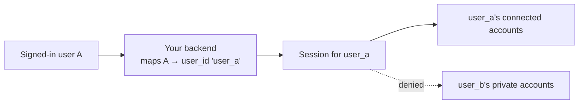
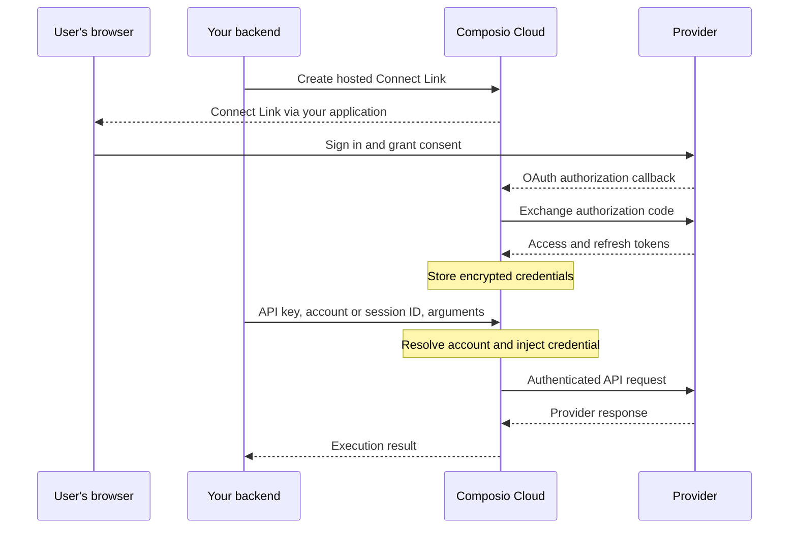

This page answers two questions security reviews ask: how Composio protects the provider credentials it stores, and how one of your users is prevented from using another user's connected accounts.

Composio stores provider credentials and uses them to execute requests on your behalf. With hosted authentication and managed execution, your application passes account identifiers and tool arguments. Composio resolves the credentials and authenticates the provider request server-side.

In the default Composio Cloud deployment, Composio has custody of those credentials. Keeping a token out of your application and keeping it outside Composio's infrastructure are different requirements. The [deployment options](#deployment-options) below describe that distinction.

For example, after connecting a GitHub account, your backend can call GitHub through [Proxy Execute](/docs/tools-direct/executing-tools#proxy-execute):

<Tabs groupId="language" items={['Python', 'TypeScript', 'API']} persist>
<Tab value="Python">
```python
from composio import Composio

composio = Composio()

response = composio.tools.proxy(
    connected_account_id="ca_your_github_account",
    endpoint="/user",
    method="GET",
)

print(response)
```
</Tab>
<Tab value="TypeScript">
```typescript
import { Composio } from '@composio/core';

const composio = new Composio();

const response = await composio.tools.proxyExecute({
  connectedAccountId: 'ca_your_github_account',
  endpoint: '/user',
  method: 'GET',
});

console.log(response);
```
</Tab>
<Tab value="API">
```bash
curl -X POST https://backend.composio.dev/api/v3.1/tools/execute/proxy \
  -H "x-api-key: $COMPOSIO_API_KEY" \
  -H "Content-Type: application/json" \
  -d '{"connected_account_id": "ca_your_github_account", "endpoint": "/user", "method": "GET"}'
```
</Tab>
</Tabs>

Replace the account ID with your connected account. Both SDKs read `COMPOSIO_API_KEY` from your environment. The key must belong to that project and have the **Proxy execute** permission. The request contains a Composio API key, which authorizes execution, but no GitHub token. Composio injects that token and returns the provider response.

## How credentials are protected

- **Encrypted provider credentials and hashed Composio keys.** Provider credentials are encrypted at rest with AES-256-GCM. Composio API keys and session keys are stored as hashes. All traffic uses TLS.
- **Used server-side, never handed back.** Composio injects the credential into the provider request during execution. Your application, your model, and your MCP client receive results, not tokens.
- **Redacted in API responses.** Connected-account reads return [redacted credential fields](#default-redaction-is-an-api-boundary), for both Composio-managed and custom auth configs.
- **Refreshed by Composio.** OAuth tokens are refreshed server-side where the provider supports it, so refresh tokens don't pass through your application.
- **API-key scope.** Requests authenticate with an API key. Session routes also accept [user API keys](/reference/authenticating-to-composio#user-api-key) in `x-user-api-key`, which can reach every project their owner can access. Prefer project API keys for application code that only needs one project. Project keys can be [restricted by permission](/reference/authenticating-to-composio/project-api-key-permissions) and IP allowlist, and [Proxy Execute](/docs/extending-sessions/proxy-execute) requires its own permission.

Encryption at rest protects stored credentials. The execution service still decrypts them to authenticate provider requests. If your requirement is that Composio cannot decrypt credentials, see [deployment options](#deployment-options).

## How user isolation works

Composio separates connected accounts at two levels: the project, and the `user_id` inside that project.

- **Projects are isolated.** Connected accounts, auth configs, sessions, and logs belong to one project. An API key for one project cannot read or use another project's connected accounts.
- **Session account selection is scoped to a user.** Each connected account is created for a `user_id`. Sessions resolve PRIVATE accounts (the default) by that user ID, so a session for user A doesn't see or execute with user B's private accounts.
- **Session sharing is explicit.** To make another user's account available to a session, create it as a [shared connection](/docs/extending-sessions/shared-connections) with an access control list. Shared accounts are deny-by-default, are never resolved implicitly, and must be pinned into a session. A disallowed user gets `ComposioSharedAccessDeniedError` (403) on direct execution, and session creation fails with `ComposioSharedConnectionNotAccessibleError` (400).
- **Optional identity check before activation.** With an [OAuth callback verifier](/docs/auth-configuration/connected-accounts#complete-deferred-oauth), Composio redirects to your application so you can confirm who completed consent. It checks project ownership and the connection's user ID before completing the token exchange.



### Direct Proxy Execute needs application authorization

[Direct Proxy Execute](/docs/tools-direct/executing-tools#proxy-execute) accepts a `connected_account_id` independently of a session. For a PRIVATE connection, Composio validates the supplied `user_id` against the account owner only when project 2FA is enabled. Without that setting, passing `user_id` does not enforce an owner check. Your backend must verify that the selected account belongs to the signed-in user before making a direct call.

For a SHARED connection, `user_id` is required and checked against the connection's access control list. This check does not depend on project 2FA. Your backend must still derive that ID from the authenticated user.

### Your backend owns identity

The `user_id` on a session is supplied by your application, not proof of who is signed in to your product. A project API key can create sessions and execute tools for any `user_id` in that project. That makes your backend the place where user A is kept from acting as user B:

- Derive the `user_id` from your authenticated session on the server. Never accept a user ID from the browser, a URL parameter, or model output.
- Keep the Composio API key on your backend. Anyone holding it can act for any user in the project.
- Use stable, immutable IDs. For multi-tenant products, include the tenant in the ID (for example, `org_42:user_7`) so that member IDs can't collide across workspaces. See [B2B agents](/docs/b2b-agents) and [consumer agents](/docs/consumer-agents).
- After a connection completes, verify that the returned connected-account ID belongs to the attempt and the signed-in user before storing it. Callback query parameters aren't proof of ownership.
- Before launch, test that two users can't see or use each other's connected accounts. See [production readiness](/docs/production-readiness).

Use separate projects when tenants need independent credentials, branding, or contractual isolation.

## Token boundaries in Composio Cloud

The following flow covers hosted OAuth and execution through Composio:



The browser participates in consent. Your backend receives connection status and identifiers. Composio stores the provider credentials, handles refresh where supported, and uses them during execution. The provider receives the credential needed to authenticate its API call.

Your model receives the tool definitions and results your application or MCP client supplies. Provider credentials are not required in prompts, tool arguments, or model context. A Composio API key is still a secret with permission to act on connected accounts, so keep it in your trusted backend or client credential store.

## Default redaction is an API boundary

Get Connected Account and List Connected Accounts redact sensitive credential fields by default. This applies to both Composio-managed and custom auth configs. Redaction happens in API responses before your application receives them; it does not depend on your application masking a token after retrieval.

The response can still contain an authentication-state object such as `account.state.val`, including field names such as `access_token`. The presence of those fields in an SDK type or response schema does not establish that the API returns usable secrets or provides an unmasking option. See [credential masking](/docs/auth-configuration/connected-accounts#credential-masking) for the response format.

Use tool execution or Proxy Execute when you need to act on an account. Reading connected-account state is not a supported token-export workflow.

This redaction has a specific scope. It does not sanitize every provider response, a secret your own code supplies, or every log your application writes. Tool results can contain sensitive business data even when the authentication token stays inside the execution service.

## Execution paths

| Path | Where code runs and credentials are used |
| --- | --- |
| Native tools through a session, MCP, or direct execution | Composio executes the provider call and supplies the connected account's credential. Your caller receives the result. |
| Proxy Execute | Composio authenticates an HTTP request to the connected provider. Use this for endpoints or request shapes that predefined tools do not cover. |
| Session extension tools | Your custom function runs in your process. Its `ctx.proxyExecute()` or `ctx.proxy_execute()` call delegates authentication and the provider request to Composio. |
| Independent local tools or imported credentials | Your code controls any secrets it reads or supplies. Importing an existing token means your application already handles that token before sending it to Composio. |

[Sessions](/docs/sessions/tool-access) and [direct execution](/docs/sessions-vs-direct-execution) also work from deterministic backend code. An LLM is not required to execute a tool or proxy request.

[Proxy Execute](/docs/extending-sessions/proxy-execute) requires absolute URLs to use the same scheme and registrable domain (eTLD+1) as the connected account's resolved base URL, so sibling subdomains are allowed. It also requires its own API-key permission. Use relative provider paths and let Composio supply authentication. Granting proxy access allows provider operations beyond predefined tool schemas, subject to the provider's permissions. Review that permission separately from tool selection.

For custom business logic, [session extension tools](/docs/extending-sessions/local-tools-and-toolkits) let your code call the proxy without reading tokens. If you instead [import credentials](/docs/authentication/importing-existing-connections) or handle authentication yourself, include those code paths in your credential review.

## OAuth app ownership and token custody

A [custom auth config](/docs/authentication/custom-app-vs-managed-app) lets you use your own OAuth app for branding, scopes, and provider quota. In Composio Cloud, Composio still stores and uses the resulting connected-account tokens. Owning the OAuth app does not move the token store into your infrastructure or change default API redaction.

## Choose your controls

Choose tool behavior, OAuth app ownership, credential custody, and retention separately. The table describes Composio Cloud unless a row points to a separate deployment arrangement.

| Choice | What your application controls | What Composio operates and the limits |
| --- | --- | --- |
| Tool schemas and business logic | Keep your tool definitions and input validation in your application with [managed authentication for your own tools](/docs/authentication/managed-auth-for-custom-tools). Select the predefined tools exposed through [sessions](/docs/sessions/tool-access). | Proxy Execute authenticates provider requests without requiring predefined tool schemas, MCP, or an LLM. The optional [local session-extension API](/docs/extending-sessions/local-tools-and-toolkits) is experimental. |
| OAuth app and provider scopes | Use [your own OAuth app](/docs/authentication/custom-app-vs-managed-app) for branding, scopes, and dedicated provider quota. Managed apps can request only the scopes their app supports. | Composio stores the resulting connected-account credentials and handles token refresh where supported. The provider grants the authorization. |
| Member or workspace connection ownership | Choose a stable `user_id` and enforce [tenant membership and roles](/docs/b2b-agents#choose-the-connection-owner) before selecting an account. | Composio associates connections with the supplied ID. That ID is not proof of identity. [Shared connections](/docs/extending-sessions/shared-connections) use explicit access-control lists and are experimental. |
| Credential retrieval and portability | Call tools or Proxy Execute using connected-account IDs. Review any workflow that [imports existing credentials](/docs/authentication/importing-existing-connections). | [Connected-account reads redact credentials](/docs/auth-configuration/connected-accounts#credential-masking). They are not a supported raw-token export workflow, including with your own OAuth app. |
| Provider operations | Restrict [project API-key permissions](/reference/authenticating-to-composio/project-api-key-permissions), provider scopes, and the endpoints your code accepts. | Proxy Execute requires its own permission and can call operations beyond predefined tool schemas. Its [provider URL restrictions](/docs/tools-direct/executing-tools#proxy-execute) still apply. |
| Execution location and key custody | Review the operator, decryption access, logs, backups, and outbound connections for your required environment. | Cloud hosts storage and execution by default. See [deployment options](#deployment-options) for the alternatives. |
| Payload retention | Have an organization admin enable [Zero Data Retention](/docs/security/zero-data-retention) for the projects that need it. Review your own logs and downstream providers separately. | ZDR is available on paid plans and included on Enterprise. It suppresses new covered execution-log payloads, keeps metadata, and has [feature and managed-app exclusions](/docs/security/zero-data-retention#what-zdr-does-not-cover). It does not change credential custody. |

## Deployment options

Where Composio runs decides who holds your credentials. [Deployment options](/docs/deployment) compares the choices in full.

| Option | Credential boundary | Availability |
| --- | --- | --- |
| Composio Cloud | Composio stores credentials and runs execution. Your application calls the hosted API. | Default |
| [BYOC](/docs/deployment/byoc) | Composio operates the services in your own cloud account. Credentials are stored and decrypted there, and provider requests leave from your network. | Enterprise, on AWS, Google Cloud, or Azure |
| Customer-managed keys | A proxy in your cloud decrypts credentials with keys in your KMS. Composio runs the rest of the deployment without that key material. | Set up with the Composio team |

The customer-managed key deployment supports AWS KMS, Google Cloud KMS, and HashiCorp Vault Transit. If no Composio service may decrypt your credentials, evaluate this option. [Contact Composio](https://composio.dev/contact?utm_source=docs) to plan either deployment.

### Customer-managed keyring transfer keys

If your organization has an active customer-managed keyring, retrieve its public transfer keys with `composio.keyring.list_transfer_keys()` in Python or `await composio.keyring.listTransferKeys()` in TypeScript. Use the key identified by `active_kid` (Python) or `activeKid` (TypeScript) when sealing new secrets for transfer. The API returns `404` if your organization has no active keyring.

## Application authorization and retained data

Your backend must bind the signed-in user to the correct Composio `user_id` and connected accounts, as described in [user isolation](#your-backend-owns-identity). Choose [provider scopes](/docs/authentication/controlling-scopes), [session tools](/docs/sessions/tool-access), and [API-key permissions](/reference/authenticating-to-composio/project-api-key-permissions) for the operations your application needs. [Per-action permissions](/docs/governance/action-permissions) shows where that session policy is enforced.

Credential redaction and payload retention are separate controls. Tool arguments and results are stored in execution logs by default. A project's [Zero Data Retention](/docs/security/zero-data-retention) setting stops storage of new call payloads for covered calls while retaining audit metadata. It does not prevent processing during execution, delete existing logs, or govern your own logs and model provider. See [data retention](/docs/security/data-retention) for file storage, Workbench processing, and retention details.

### Where payloads go and how long they stay

The [data-handling policy](/docs/security/data-retention#where-your-data-goes) describes processing by Composio's execution infrastructure, destination providers, and any enabled file, trigger, or sandbox paths. Keeping provider tokens out of your application does not keep tool arguments and results out of those paths.

- [Tool execution and trigger event logs](/docs/security/data-retention#how-long-logs-are-retained) are retained for up to one year. Organization deletion removes execution logs, including request and response payloads, within 30 days.
- [Staged files](/docs/security/data-retention#how-long-files-are-available) are deleted after 24 hours. Presigned URLs expire after one hour by default; URL expiry does not delete the file.
- [ZDR coverage](/docs/security/zero-data-retention#what-zdr-covers) applies to new covered tool and proxy calls. Composio-managed OAuth apps are covered only on Enterprise. Triggers, sandbox state, files, search caching, and third-party retention have [separate limits](/docs/security/zero-data-retention#what-zdr-does-not-cover). Audit logs and telemetry [remain stored](/docs/security/zero-data-retention#always-stored).

For compliance reports and the current sub-processor list, use the [Composio Trust Center](https://trust.composio.dev).
