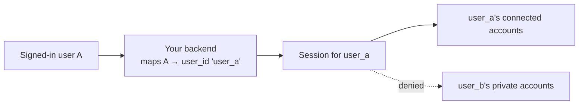
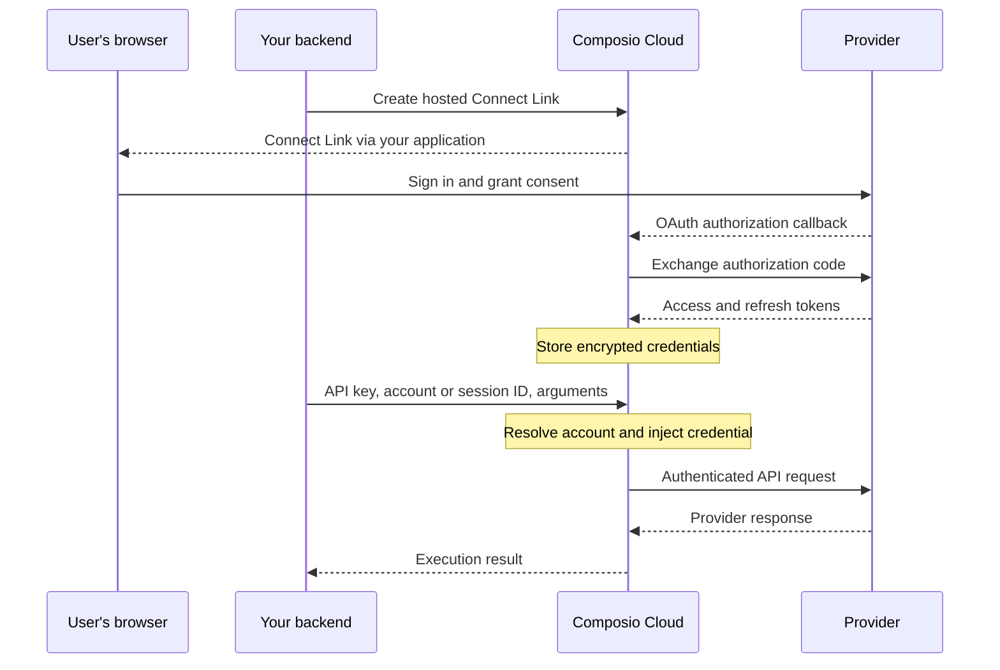

This page answers two questions security reviews ask: how Composio protects the provider credentials it stores, and how one of your users is prevented from using another user's connected accounts.

Composio stores provider credentials and uses them to execute requests on your behalf. With hosted authentication and managed execution, your application passes account identifiers and tool arguments. Composio resolves the credentials and authenticates the provider request server-side.

In the default Composio Cloud deployment, Composio has custody of those credentials. Keeping a token out of your application and keeping it outside Composio's infrastructure are different requirements. The [deployment options](#deployment-options) below describe that distinction.

For example, after connecting a GitHub account, your backend can call GitHub through [Proxy Execute](/docs/tools-direct/executing-tools#proxy-execute):

<Tabs groupId="language" items={['Python', 'TypeScript', 'API']} persist>
<Tab value="Python">
```python
from composio import Composio

composio = Composio()

response = composio.tools.proxy(
    connected_account_id="ca_your_github_account",
    endpoint="/user",
    method="GET",
)

print(response)
```
</Tab>
<Tab value="TypeScript">
```typescript
import { Composio } from '@composio/core';

const composio = new Composio();

const response = await composio.tools.proxyExecute({
  connectedAccountId: 'ca_your_github_account',
  endpoint: '/user',
  method: 'GET',
});

console.log(response);
```
</Tab>
<Tab value="API">
```bash
curl -X POST https://backend.composio.dev/api/v3.1/tools/execute/proxy \
  -H "x-api-key: $COMPOSIO_API_KEY" \
  -H "Content-Type: application/json" \
  -d '{"connected_account_id": "ca_your_github_account", "endpoint": "/user", "method": "GET"}'
```
</Tab>
</Tabs>

Replace the account ID with your connected account. Both SDKs read `COMPOSIO_API_KEY` from your environment. The key must belong to that project and have the **Proxy execute** permission. The request contains a Composio API key, which authorizes execution, but no GitHub token. Composio injects that token and returns the provider response.

## How credentials are protected

- **Encrypted at rest and in transit.** Connected-account credentials, auth configs, and API keys are encrypted at rest with AES-256-GCM. All traffic uses TLS.
- **Used server-side, never handed back.** Composio injects the credential into the provider request during execution. Your application, your model, and your MCP client receive results, not tokens.
- **Redacted in API responses.** Connected-account reads return [redacted credential fields](#default-redaction-is-an-api-boundary), for both Composio-managed and custom auth configs.
- **Refreshed by Composio.** OAuth tokens are refreshed server-side where the provider supports it, so refresh tokens don't pass through your application.
- **Scoped project API keys.** Every request is authorized by a project API key. Keys can be [restricted by permission](/reference/authenticating-to-composio/project-api-key-permissions) and IP allowlist, and [Proxy Execute](/docs/extending-sessions/proxy-execute) requires its own permission.

Encryption at rest protects stored credentials; the execution service still decrypts them to authenticate provider requests. If your requirement is that Composio cannot decrypt credentials, see [deployment options](#deployment-options).

## How user isolation works

Composio separates connected accounts at two levels: the project, and the `user_id` inside that project.

- **Projects are isolated.** Connected accounts, auth configs, sessions, and logs belong to one project. An API key for one project cannot read or use another project's connected accounts.
- **Connected accounts are private to their user by default.** Each connected account is created for a `user_id`. A PRIVATE account (the default) can be used only by the `user_id` that owns it. Sessions resolve accounts by that user ID, so a session for user A doesn't see or execute with user B's accounts.
- **Sharing is explicit.** An account becomes usable by other users only if you create it as a [shared connection](/docs/extending-sessions/shared-connections) with an access control list. Shared accounts are deny-by-default, are never resolved implicitly, and must be pinned into a session. A disallowed user gets `ComposioSharedAccessDeniedError` (403) on direct execution, and session creation fails with `ComposioSharedConnectionNotAccessibleError` (400).
- **Optional identity check before activation.** With an [OAuth callback verifier](/docs/auth-configuration/connected-accounts#complete-deferred-oauth), Composio redirects to your application so you can confirm who completed consent. It checks project ownership and the connection's user ID before completing the token exchange.



### Your backend owns identity

Composio enforces the `user_id` boundary, but it doesn't know who is signed in to your product. A project API key can create sessions and execute tools for any `user_id` in that project. That makes your backend the place where user A is kept from acting as user B:

- Derive the `user_id` from your authenticated session on the server. Never accept a user ID from the browser, a URL parameter, or model output.
- Keep the Composio API key on your backend. Anyone holding it can act for any user in the project.
- Use stable, immutable IDs. For multi-tenant products, include the tenant in the ID (for example, `org_42:user_7`) so that member IDs can't collide across workspaces. See [B2B agents](/docs/b2b-agents) and [consumer agents](/docs/consumer-agents).
- After a connection completes, verify that the returned connected-account ID belongs to the attempt and the signed-in user before storing it. Callback query parameters aren't proof of ownership.
- Before launch, test that two users can't see or use each other's connected accounts. See [production readiness](/docs/production-readiness).

Use separate projects when tenants need independent credentials, branding, or contractual isolation.

## Token boundaries in Composio Cloud

The following flow covers hosted OAuth and execution through Composio:



The browser participates in consent. Your backend receives connection status and identifiers. Composio stores the provider credentials, handles refresh where supported, and uses them during execution. The provider receives the credential needed to authenticate its API call.

Your model receives the tool definitions and results your application or MCP client supplies. Provider credentials are not required in prompts, tool arguments, or model context. A Composio API key is still a secret with permission to act on connected accounts, so keep it in your trusted backend or client credential store.

## Default redaction is an API boundary

Get Connected Account and List Connected Accounts redact sensitive credential fields by default. This applies to both Composio-managed and custom auth configs. Redaction happens in API responses before your application receives them; it does not depend on your application masking a token after retrieval.

The response can still contain an authentication-state object such as `account.state.val`, including field names such as `access_token`. The presence of those fields in an SDK type or response schema does not establish that the API returns usable secrets or provides an unmasking option. See [credential masking](/docs/auth-configuration/connected-accounts#credential-masking) for the response format.

Use tool execution or Proxy Execute when you need to act on an account. Reading connected-account state is not a supported token-export workflow.

This redaction has a specific scope. It does not sanitize every provider response, a secret your own code supplies, or every log your application writes. Tool results can contain sensitive business data even when the authentication token stays inside the execution service.

## Execution paths

| Path | Where code runs and credentials are used |
| --- | --- |
| Native tools through a session, MCP, or direct execution | Composio executes the provider call and supplies the connected account's credential. Your caller receives the result. |
| Proxy Execute | Composio authenticates an HTTP request to the connected provider. Use this for endpoints or request shapes that predefined tools do not cover. |
| Session extension tools | Your custom function runs in your process. Its `ctx.proxyExecute()` or `ctx.proxy_execute()` call delegates authentication and the provider request to Composio. |
| Independent local tools or imported credentials | Your code controls any secrets it reads or supplies. Importing an existing token means your application already handles that token before sending it to Composio. |

[Sessions](/docs/configuring-sessions) and [direct execution](/docs/sessions-vs-direct-execution) also work from deterministic backend code. An LLM is not required to execute a tool or proxy request.

[Proxy Execute](/docs/extending-sessions/proxy-execute) requires absolute URLs to use the same scheme and registrable domain (eTLD+1) as the connected account's resolved base URL, so sibling subdomains are allowed. It also requires its own API-key permission. Use relative provider paths and let Composio supply authentication. Granting proxy access allows provider operations beyond predefined tool schemas, subject to the provider's permissions. Review that permission separately from tool selection.

For custom business logic, [session extension tools](/docs/extending-sessions/local-tools-and-toolkits) let your code call the proxy without reading tokens. If you instead [import credentials](/docs/authentication/importing-existing-connections) or handle authentication yourself, include those code paths in your credential review.

## OAuth app ownership and token custody

A [custom auth config](/docs/authentication/custom-app-vs-managed-app) lets you use your own OAuth app for branding, scopes, and provider quota. In Composio Cloud, Composio still stores and uses the resulting connected-account tokens. Owning the OAuth app does not move the token store into your infrastructure or change default API redaction.

## Deployment options

| Option | Credential boundary | Availability |
| --- | --- | --- |
| Composio Cloud | Composio hosts credential storage and execution. Your application calls the managed API. | Default hosted deployment. |
| [Bring your own cloud (BYOC)](/docs/security/byoc) | Composio operates the application services in your AWS account. Credentials are stored and used there, and provider requests originate from your environment. Runtime and support permissions determine who can access plaintext. | Enterprise arrangement on AWS. |
| Customer-managed key deployment | A proxy in your cloud handles credential plaintext under keys in your KMS. Composio retains the control plane without the key material needed to decrypt those credentials. | Set up with the Composio team, rather than enabled by a dashboard toggle. |

BYOC replaces the previous customer-operated Helm offering for new deployments. The [Helm troubleshooting guide](/kb/guide/platform-self-hosted-helm) remains available for existing installations.

The [customer-managed key architecture](https://composio.dev/blog/two-questions-every-security-review-asks-us) supports AWS KMS, Google Cloud KMS, and HashiCorp Vault Transit. It is separate from BYOC and from bringing your own OAuth app.

If your requirement is that Composio cannot decrypt provider credentials, evaluate the customer-managed key arrangement with the team. Running in your account with BYOC doesn't by itself establish that. For any deployment, confirm who operates each service, who can decrypt credentials, where logs and backups reside, and which outbound connections are required. [Contact Composio](https://composio.dev/contact?utm_source=docs) to establish the architecture and contractual requirements.

### Customer-managed keyring transfer keys

If your organization has an active customer-managed keyring, retrieve its public transfer keys with `composio.keyring.list_transfer_keys()` in Python or `await composio.keyring.listTransferKeys()` in TypeScript. Use the key identified by `active_kid` (Python) or `activeKid` (TypeScript) when sealing new secrets for transfer. The API returns `404` if your organization has no active keyring.

## Application authorization and retained data

Your backend must bind the signed-in user to the correct Composio `user_id` and connected accounts, as described in [user isolation](#your-backend-owns-identity). Choose [provider scopes](/docs/authentication/controlling-scopes), [session tools](/docs/configuring-sessions), and [API-key permissions](/reference/authenticating-to-composio/project-api-key-permissions) for the operations your application needs.

Credential redaction and payload retention are separate controls. Tool arguments and results are stored in execution logs by default. A project's [Zero Data Retention](/docs/security/zero-data-retention) setting stops storage of new call payloads for covered calls while retaining audit metadata. It does not prevent processing during execution, delete existing logs, or govern your own logs and model provider. See [data retention](/docs/security/data-retention) for file storage, Workbench processing, and retention details.

For compliance reports and the current sub-processor list, use the [Composio Trust Center](https://trust.composio.dev).
