A **session** is the runtime context for an agentic run: the scoped environment an AI agent works in while it acts for one of your users. You create it with `composio.create(userId)`, and it ties together the user, the toolkits available, authentication, and connected accounts. By default it gives the agent meta tools to discover, authenticate, and execute app tools at runtime, instead of loading hundreds of tool definitions into context.

## What comes in a session
By default, a session gives your agent meta tools to discover and execute app tools and manage connections for your user. All toolkits are discoverable, and search includes skill guidance when a matching skill exists. Standard sessions also include a [sandbox](/docs/sessions/sandbox-settings#sandbox) for processing files and large responses outside the model's context window. You can restrict tool access or disable the sandbox through [session configuration](/docs/sessions/tool-access).

Use [tool access rules](/docs/sessions/tool-access), [tool loading](/docs/sessions/loading-tools), [connection selection](/docs/sessions/connections), and [sandbox options](/docs/sessions/sandbox-settings) to configure a session for your task.

```mermaid
architecture-beta
    group session(lucide:box)[Composio Session]

    service toolsearch(lucide:book-search)[Tool Search] in session
    service toolkits(lucide:toolbox)[Toolkits] in session
    service tools(lucide:wrench)[Tools] in session
    service sandbox(lucide:scan-box)[Sandbox] in session

    service user(lucide:user)[User Context] in session
    service auth(lucide:lock)[Authentication] in session

    user:R -- L:auth
    toolsearch:R -- L:toolkits
    toolkits:B -- T:tools
```



## Users

A user is an identifier from your app. Composio stores connections under that ID, so tools run with the right account and stay isolated from other users. Use a stable identifier like your database ID, never one that can change.

<Accordions>
<Accordion title="userID best practices">
- **Recommended:** database UUID or primary key (`user.id`)
- **Acceptable:** unique username (`user.username`)
- **Avoid:** email addresses (they can change)
- **Never:** `default` in production (it exposes other users' data)
</Accordion>
</Accordions>

A user can connect multiple accounts for the same toolkit, like work and personal Gmail. Use the same userID, then select the connected account when a session needs a specific one. See [Managing multiple connected accounts](/docs/authentication/managing-multiple-connected-accounts).

## Creating a session

<Tabs groupId="language" items={['Python', 'TypeScript', 'API']} persist>
<Tab value="Python">
```python
session = composio.sessions.create(user_id="user_123")
```
</Tab>
<Tab value="TypeScript">
```typescript
import { Composio } from '@composio/core';
const composio = new Composio({ apiKey: 'your_api_key' });
// ---cut---
const session = await composio.create("user_123");
```
</Tab>
<Tab value="API">
```bash
curl -X POST https://backend.composio.dev/api/v3.1/tool_router/session \
  -H "x-api-key: $COMPOSIO_API_KEY" \
  -H "Content-Type: application/json" \
  -d '{"user_id": "user_123"}'
```
</Tab>
</Tabs>

By default, a session has access to every toolkit in the Composio catalog. Your agent can discover and use any of them through `COMPOSIO_SEARCH_TOOLS`. Use the options below to restrict or customize what's available.

You can also attach local tools and local toolkits that run in-process alongside Composio tools. See [Local tools and toolkits](/docs/extending-sessions/local-tools-and-toolkits).

<Callout type="warn">
Both SDKs pass product and runtime identity through the API client's `identity` option. If you configure custom default or request headers, remove identity headers such as `x-source`, `x-framework`, `x-sdk-version`, and `x-client-*`. The client rejects attempts to override them.
</Callout>

### API key permissions

If you use a [scoped project API key](/reference/authenticating-to-composio/project-api-key-permissions), grant permissions for the session operations your application needs:

- **Session management** controls creating, viewing, configuring, and deleting sessions. It does not grant tool execution access.
- **Session tool execution** covers search, tool execution, proxy execution, and session-linked MCP access.

Enable both permissions if your application manages sessions and executes tools through them.

## The basics

Create a session for a user, then read its tools formatted for your framework. To connect over MCP instead, see [Using sessions via MCP](/docs/sessions/sessions-via-mcp).

<Tabs groupId="language" items={['Python', 'TypeScript', 'API']} persist>
<Tab value="Python">
```python
session = composio.sessions.create(user_id="user_123")

tools = session.tools()
```
</Tab>
<Tab value="TypeScript">
```typescript
import { Composio } from '@composio/core';
const composio = new Composio({ apiKey: 'your_api_key' });
// ---cut---
const session = await composio.create("user_123");

const tools = await session.tools();
```
</Tab>
<Tab value="API">
```bash
SESSION_ID=$(curl -s -X POST https://backend.composio.dev/api/v3.1/tool_router/session \
  -H "x-api-key: $COMPOSIO_API_KEY" \
  -H "Content-Type: application/json" \
  -d '{"user_id": "user_123"}' | jq -r '.session_id')

curl -X GET https://backend.composio.dev/api/v3.1/tool_router/session/$SESSION_ID/tools \
  -H "x-api-key: $COMPOSIO_API_KEY"
```
</Tab>
</Tabs>

A session scopes four things:

- **userID**: whose connected accounts and tool executions are in scope.
- **Tool access**: all toolkits by default, or a filtered set of toolkits, tools, or tags.
- **Authentication**: managed auth, custom auth configs, and connected-account selection.
- **Execution state**: logs, tool memory, MCP state, and workbench files for the task.

## How sessions behave

Every `create()` call returns a new session ID. Use it for a fresh task context.

Sessions persist on the server and don't expire. For multi-turn conversations, store the session ID and reuse it with `composio.use()` instead of calling `create()` again.

<Tabs groupId="language" items={['Python', 'TypeScript', 'API']} persist>
<Tab value="Python">
```python
session = composio.use("session_id")
tools = session.tools()
```
</Tab>
<Tab value="TypeScript">
```typescript
import { Composio } from '@composio/core';
const composio = new Composio({ apiKey: 'your_api_key' });
// ---cut---
const session = await composio.use("session_id");
const tools = await session.tools();
```
</Tab>
<Tab value="API">
```bash
curl -X GET https://backend.composio.dev/api/v3.1/tool_router/session/session_id \
  -H "x-api-key: $COMPOSIO_API_KEY"

curl -X GET https://backend.composio.dev/api/v3.1/tool_router/session/session_id/tools \
  -H "x-api-key: $COMPOSIO_API_KEY"
```
</Tab>
</Tabs>

You can also update a session in place instead of creating a new one:

<Tabs groupId="language" items={['Python', 'TypeScript', 'API']} persist>
<Tab value="Python">
```python
session.update(
    toolkits={"enable": ["gmail", "slack"]},
    auth_configs={"gmail": "ac_new_config"},
    connected_accounts={"slack": ["ca_work_slack"]},
)
```
</Tab>
<Tab value="TypeScript">
```typescript
import { Composio } from '@composio/core';
const composio = new Composio({ apiKey: 'your_api_key' });
const session = await composio.use("session_id");
// ---cut---
await session.update({
  toolkits: ["gmail", "slack"],
  authConfigs: { gmail: "ac_new_config" },
  connectedAccounts: { slack: ["ca_work_slack"] },
});
```
</Tab>
<Tab value="API">
```bash
curl -X PATCH https://backend.composio.dev/api/v3.1/tool_router/session/session_id \
  -H "x-api-key: $COMPOSIO_API_KEY" \
  -H "Content-Type: application/json" \
  -d '{
    "toolkits": {"enable": ["gmail", "slack"]},
    "auth_configs": {"gmail": "ac_new_config"},
    "connected_accounts": {"slack": ["ca_work_slack"]}
  }'
```
</Tab>
</Tabs>

Create a new session for a different user or a fundamentally different task setup. Reuse or update a session when the same conversation should keep its tool, auth, and workbench context.

## delete()

Delete a session when you're done with it. Deleted sessions immediately stop being retrievable or executable, and the call returns the deleted `session_id`. Deleting a missing or already-deleted session surfaces the backend `404`.

<Callout type="info">
Requires `@composio/core` ≥ `0.13.1` (TypeScript) or `composio` ≥ `0.17.1` (Python).
</Callout>

<Tabs groupId="language" items={['Python', 'TypeScript', 'API']} persist>
<Tab value="Python">
```python
result = session.delete()
print(result["session_id"], result["deleted"])
```
</Tab>
<Tab value="TypeScript">
```typescript
import { Composio } from '@composio/core';
const composio = new Composio({ apiKey: 'your_api_key' });
const session = await composio.create('user_123');
// ---cut---
const result = await session.delete();
console.log(result.sessionId, result.deleted);
```
</Tab>
<Tab value="API">
```bash
curl -X DELETE https://backend.composio.dev/api/v3.1/tool_router/session/$SESSION_ID \
  -H "x-api-key: $COMPOSIO_API_KEY"
```
</Tab>
</Tabs>

## Related guides

For framework examples, see [OpenAI](/docs/providers/openai) or [Vercel AI SDK](/docs/providers/vercel). To connect over MCP, see [Using sessions via MCP](/docs/sessions/sessions-via-mcp).
