A **session** is the runtime context for an agentic run: the scoped environment an AI agent works in while it acts for one of your users. You create it with `composio.create(userId)`, and it ties together the user, the toolkits available, authentication, and connected accounts. By default it gives the agent meta tools to discover, authenticate, and execute app tools at runtime, instead of loading hundreds of tool definitions into context.

## Choose a task

- [Create and reuse](/docs/sessions/create-and-reuse): Create a session, continue it across turns, and delete it when the task is finished.
- [Restrict tool access](/docs/sessions/tool-access): Choose which toolkits and tools the agent can use.
- [Saved session policies](/docs/sessions/saved-session-policies): Apply a named policy to new sessions.
- [Load tools](/docs/sessions/loading-tools): Load meta tools, preload tools, or use the direct tools preset.
- [Select connections](/docs/sessions/connections): Choose connected accounts and configure authentication.
- [Set sandbox options](/docs/sessions/sandbox-settings): Choose the sandbox compute tier or turn the sandbox off.
- [Update a session](/docs/sessions/updating-sessions): Change a running session's configuration and inspect its history.
- [Execute session tools](/docs/sessions/executing-tools): Run tools, read results, and handle requests for user input.

If you only need authentication for tools you already own, follow [managed authentication for your own tools](/docs/authentication/managed-auth-for-custom-tools). Use a session to create a Connect Link, then call provider APIs through Proxy Execute from your own code. You don't need to fetch tool schemas or replace your tools with catalog actions.

## What comes in a session
By default, a session gives your agent meta tools to discover and execute app tools and manage connections for your user. All toolkits are discoverable, and search includes skill guidance when a matching skill exists. Standard sessions also include a [sandbox](/docs/sessions#sandbox) for processing files and large responses outside the model's context window. You can restrict tool access or disable the sandbox through [session configuration](/docs/sessions/tool-access).

Use [tool access rules](/docs/sessions/tool-access), [tool loading](/docs/sessions/loading-tools), [connection selection](/docs/sessions/connections), and [sandbox options](/docs/sessions/sandbox-settings) to configure a session for your task.

```mermaid
architecture-beta
    group session(lucide:box)[Composio Session]

    service toolsearch(lucide:book-search)[Tool Search] in session
    service toolkits(lucide:toolbox)[Toolkits] in session
    service tools(lucide:wrench)[Tools] in session
    service sandbox(lucide:scan-box)[Sandbox] in session

    service user(lucide:user)[User Context] in session
    service auth(lucide:lock)[Authentication] in session

    user:R -- L:auth
    toolsearch:R -- L:toolkits
    toolkits:B -- T:tools
```

Below we're going to explain each of the concepts that come with a session.

## Users

A user is an identifier from your app. Composio stores connections under that ID, so tools run with the right account and stay isolated from other users. Use a stable identifier like your database ID, never one that can change.

<Accordions>
<Accordion title="userID best practices">
- **Recommended:** database UUID or primary key (`user.id`)
- **Acceptable:** unique username (`user.username`)
- **Avoid:** email addresses (they can change)
- **Never:** `default` in production (it exposes other users' data)
</Accordion>
</Accordions>

A user can connect multiple accounts for the same toolkit, like work and personal Gmail. Use the same userID, then select the connected account when a session needs a specific one. See [Managing multiple connected accounts](/docs/authentication/managing-multiple-connected-accounts).

## Authentication

When a tool needs a connection, the session generates a Connect Link with `session.authorize()`, or the agent handles the flow through `COMPOSIO_MANAGE_CONNECTIONS`.

In chat, the agent can pause, ask the user to connect an app, then retry the tool once auth completes. Composio manages the OAuth redirects, token exchange, and refresh. Once a user connects a toolkit, the connected account persists and future sessions reuse it without re-authentication.

For OAuth toolkits, Composio uses [managed apps](/docs/authentication/custom-app-vs-managed-app) by default. Bring your own app when you need your own branding, scopes, or consent screen.

## Tools and Toolkits

A **toolkit** is a collection of related tools for a service. The `github` toolkit, for example, contains tools for creating issues, managing pull requests, and starring repositories.

A **tool** is an individual action your agent can execute. Each tool has an input schema (its parameters) and an output schema (what it returns), and follows a `{TOOLKIT}_{ACTION}` naming pattern, like `GITHUB_CREATE_AN_ISSUE`.

See [Toolkits](/docs/toolkits) for how tools are grouped, discovered, and used with connected accounts.

Every toolkit in the catalog is discoverable by default. Create a session without a `toolkits` parameter and the agent can find any of them at runtime. To restrict the set, pass `toolkits` when you create the session. See [Enable and disable toolkits](/docs/sessions/tool-access#enabling-toolkits). You can also bind local, in-process tools to a session with the experimental [local tools and toolkits](/docs/extending-sessions/local-tools-and-toolkits) API.

### Meta tools

A session gives your agent meta tools, a small fixed set that discover, authenticate, and execute tools at runtime, so you never load hundreds of tool definitions into context:

<SessionFlow />

The agent searches for relevant tools, authenticates if needed, and executes them through the same session. Meta-tool calls share context, so the agent searches in one call and executes in the next without losing state. See the [Meta Tools reference](/toolkits/meta-tools) for each tool's input and output schema.

Know the exact tools upfront? The [direct tools preset](/docs/sessions/loading-tools#direct-tools-preset) returns them directly from `session.tools()` with no search step, while keeping session auth, connected accounts, and the workbench.

## Sandbox

Handle large responses and bulk operations in the remote sandbox. Instead of stuffing long tool responses into the model context, the agent reads files, searches outputs, writes Python, transforms data, and calls Composio tools in bulk.

The sandbox is scoped to the session, so files, variables, helper functions, and intermediate results stay available while the agent works through a task. Learn more about [sandboxes here](/docs/sandbox/remote).

## Next

<Card icon={<Wrench />} title="Create and reuse" href="/docs/sessions/create-and-reuse" description="Create a session, reuse it across turns, and delete it when the task is finished" />
