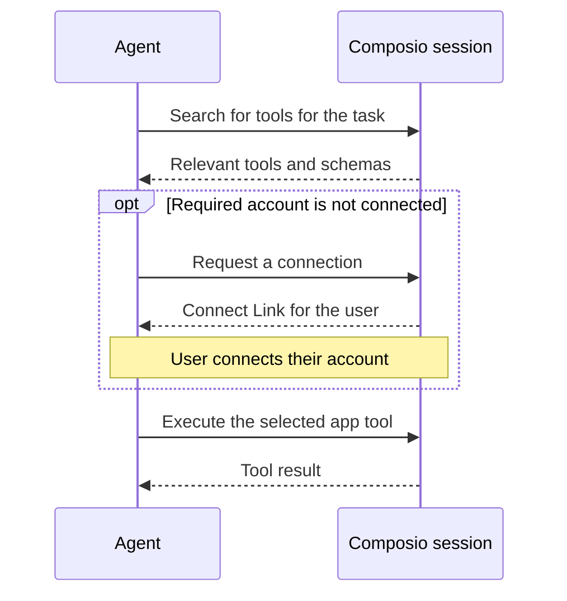

An agent that works across apps needs to find the right tools, connect your user's accounts, and keep track of its work across turns. A **session** brings those pieces together for one task. For example, an agent can find an email in Gmail and post a summary to Slack using the same user's connections.

A session scopes the agent's tools, authentication, connected accounts, and execution state to one user. Create a session for a task, then reuse it across turns.

## How a session works

By default, your agent gets **meta tools**: tools that discover app tools, manage connections, and execute actions. This lets the agent find tools as the task develops without loading the full catalog of tool definitions into the model's context.

The agent searches, connects when needed, and executes through the same session. By default, every toolkit in the catalog is discoverable. You can [restrict tool access](/docs/sessions/tool-access) to fit the task. If you already know which tools the agent needs, [load them directly](/docs/sessions/loading-tools#direct-tools-preset).

Store the session ID and reuse it across conversation turns to keep the task's execution state. Connected accounts belong to the user and can be reused in future sessions. See [Create and reuse](/docs/sessions/create-and-reuse) for session creation and reuse, and [Select connections](/docs/sessions/connections) for account selection.

## Choose a task

- [Create and reuse](/docs/sessions/create-and-reuse): Create a session, continue it across turns, and delete it when the task is finished.
- [Restrict tool access](/docs/sessions/tool-access): Choose which toolkits and tools the agent can use.
- [Saved session policies](/docs/sessions/saved-session-policies): Apply a named policy to new sessions.
- [Load tools](/docs/sessions/loading-tools): Load meta tools, preload tools, or use the direct tools preset.
- [Select connections](/docs/sessions/connections): Choose connected accounts and configure authentication.
- [Set sandbox options](/docs/sessions/sandbox-settings): Choose the sandbox compute tier or turn the sandbox off.
- [Update a session](/docs/sessions/updating-sessions): Change a running session's configuration and inspect its history.
- [Execute session tools](/docs/sessions/executing-tools): Run tools, read results, and handle requests for user input.
- [Tool execution hooks](/docs/sessions/hooks): Block or modify tool calls before a tool runs and after it returns.
