# CLI state machines

Seven implicit state machines govern the CLI's highest-impact user flows. Each has
a local verification skill, a finite TLA+ model, a TLC-generated Mermaid statechart,
and an SVG rendered with Pele.

```bash
bun ts/packages/cli/scripts/formal/verify.ts execution --mutations
```

Replace `execution` with `login`, `link`, `routing`, `listener`, `shutdown`, or
`invocation`. The verifier checks the model and existing tests in a scratch copy.
With `--mutations`, it also removes a guard in that copy, requires an assertion
failure, restores it, and requires the same test to pass. In scratch only,
`Effect.flip` expectations observe the full `Exit` before asserting, so unexpected
successes and defects become explicit public-contract assertions. The checkout's
tests remain untouched. Dependencies must already
be installed. The first run installs checksum-pinned TLC 1.7.4 and pinned Java
through mise; it needs network access. Subsequent runs reuse them.

## Priority and ownership

Priority reflects the harm of a broken transition and the difficulty of exercising
its ordering in ordinary tests. It is an engineering judgment, not usage telemetry.

| Priority | Subsystem and skill                                                                                 | Why it matters                                                                                                                                                                                          |
| -------- | --------------------------------------------------------------------------------------------------- | ------------------------------------------------------------------------------------------------------------------------------------------------------------------------------------------------------- |
| 1        | [Execute a tool](../../../../../.agents/skills/verify-cli-execution/SKILL.md)                       | An unintended execution can mutate external data or incur a charge. Dry-run, permission, transport, remote outcome, and local output are separate decisions.                                            |
| 2        | [Choose the acting identity and account](../../../../../.agents/skills/verify-cli-routing/SKILL.md) | A correct tool call under the wrong project, user, or account can affect the wrong mailbox or workspace. The high-level ambiguity guard matters even though the lower-level selector can choose newest. |
| 3        | [Sign in](../../../../../.agents/skills/verify-cli-login/SKILL.md)                                  | Browser approval and local credential persistence cross CLI invocations. A cached URL or pending session is not a verified login.                                                                       |
| 4        | [Connect an account](../../../../../.agents/skills/verify-cli-link/SKILL.md)                        | Creating an authorization link and confirming an ACTIVE account are different outcomes. A pending link must remain visibly pending.                                                                     |
| 5        | [Listen and stop](../../../../../.agents/skills/verify-cli-listener/SKILL.md)                       | Subscription acknowledgment, event callbacks, sink writes, stop conditions, and trigger cleanup can overlap. An exit code alone cannot prove delivery.                                                  |
| 6        | [Stop a supervised script](../../../../../.agents/skills/verify-cli-shutdown/SKILL.md)              | The first signal, scoped cooperation, child process groups, escalation timers, and the final exit status interact across several modules.                                                               |
| 7        | [Parse, dispatch, and report](../../../../../.agents/skills/verify-cli-invocation/SKILL.md)         | Parsing determines identity. Help, version, parse failures, hooks, authentication checks, telemetry, and reporting must retain their order.                                                             |

## Verification result

Checked on 2026-11-09 against source commit
`149514f2659eab97138c0d1781e7fa8de4e8b343`, with file hashes covering the
actual source, model, and verifier. [Receipts](evidence.json) record the tool versions,
lockfile hash, selected tests, and failing assertions from the deliberate mutations.

- All seven safety invariants and deadlock checks pass across 841 reachable states.
- All 214 selected existing behavior tests pass.
- Each of seven broken models violates its named invariant.
- Each corresponding TypeScript mutation causes assertion failures in existing tests.
- All 21 selected restoration checks pass after dropping the source mutations.

These results cover the stated finite models, not every execution of the
TypeScript or the remote services. Each skill's coverage record names the atomic
steps, assumptions, excluded cases, and confirmation commit. Source hashes stop
the verifier when a covered file changes; they do not prove model equivalence.
The negative-control charts below depict deliberately broken copies. They are
not findings against the current CLI.

## Read the user flows

Start with sign-in, connect an account, and execute. Use the listener and shutdown
charts for long-running work. Invocation is the shared envelope around each command.
The charts merge equivalent visible states and omit transitions that remain inside
one visible state. They do not otherwise filter arrows. Each generated report lists
the number of hidden steps. In particular, per-event writes, intermediate retries,
and child grace-period changes can remain inside a visible state.

### Sign in

[Skill and scope](../../../../../.agents/skills/verify-cli-login/SKILL.md) · [SVG](login/current.svg) · [Mermaid](login/current.mmd) · [TLC report](login/current-report.md)


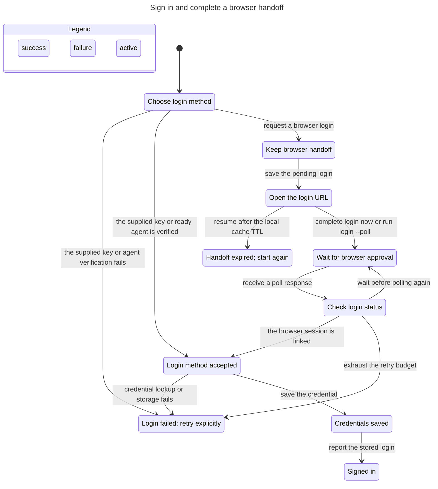

`BrowserSessionMustBeLinked` holds in 65 reachable states.

Negative control: Accept an unlinked session in requireLinkedNow. The existing no-wait pending-session test must fail.

The shortest path has 5 steps: 0. Choose login method

1. request a browser login: Keep browser handoff
2. save the pending login: Open the login URL
3. complete login now or run login --poll: Wait for browser approval
4. receive a poll response: Check login status
5. accept an unlinked browser session: Unlinked browser session incorrectly accepted

[Broken-copy chart](login/counterexample.svg) · [Mermaid](login/counterexample.mmd) · [Counterexample report](login/counterexample-report.md)

### Connect an account

[Skill and scope](../../../../../.agents/skills/verify-cli-link/SKILL.md) · [SVG](link/current.svg) · [Mermaid](link/current.mmd) · [TLC report](link/current-report.md)


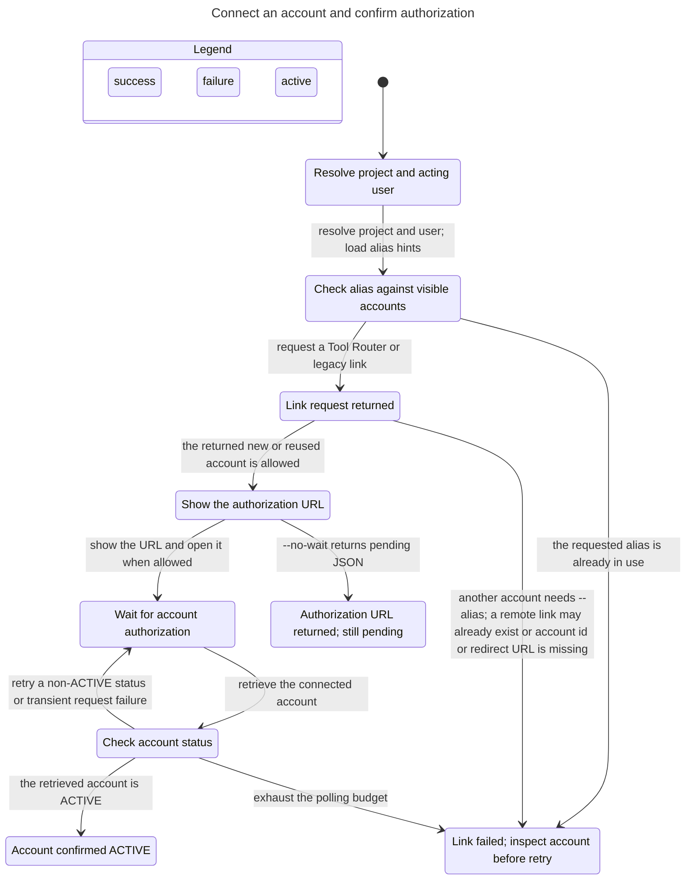

`ActiveOutputRequiresActiveAccount` holds in 62 reachable states.

Negative control: Accept the first non-ACTIVE account response as a successful authorization. The existing never-ACTIVE contract must fail.

The shortest path has 6 steps: 0. Resolve project and acting user

1. resolve project and user; load alias hints: Check alias against visible accounts
2. request a Tool Router or legacy link: Link request returned
3. the returned new or reused account is allowed: Show the authorization URL
4. show the URL and open it when allowed: Wait for account authorization
5. retrieve the connected account: Check account status
6. incorrectly announce a non-ACTIVE account: Reports ACTIVE before account authorization

[Broken-copy chart](link/counterexample.svg) · [Mermaid](link/counterexample.mmd) · [Counterexample report](link/counterexample-report.md)

### Choose the acting identity and account

[Skill and scope](../../../../../.agents/skills/verify-cli-routing/SKILL.md) · [SVG](routing/current.svg) · [Mermaid](routing/current.mmd) · [TLC report](routing/current-report.md)


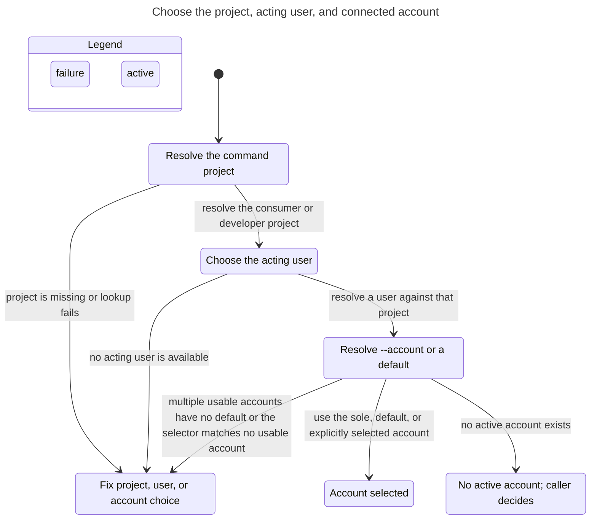

`NoAmbiguousAccountChosen` holds in 96 reachable states.

Negative control: Remove the high-level ambiguity guard. The unchanged low-level resolver then silently picks newest, and the existing ambiguity assertions must fail.

The shortest path has 3 steps: 0. Resolve the command project

1. resolve the consumer or developer project: Choose the acting user
2. resolve a user against that project: Resolve --account or a default
3. silently choose the newest account: Newest account guessed despite ambiguity

[Broken-copy chart](routing/counterexample.svg) · [Mermaid](routing/counterexample.mmd) · [Counterexample report](routing/counterexample-report.md)

### Execute a tool

[Skill and scope](../../../../../.agents/skills/verify-cli-execution/SKILL.md) · [SVG](execution/current.svg) · [Mermaid](execution/current.mmd) · [TLC report](execution/current-report.md)


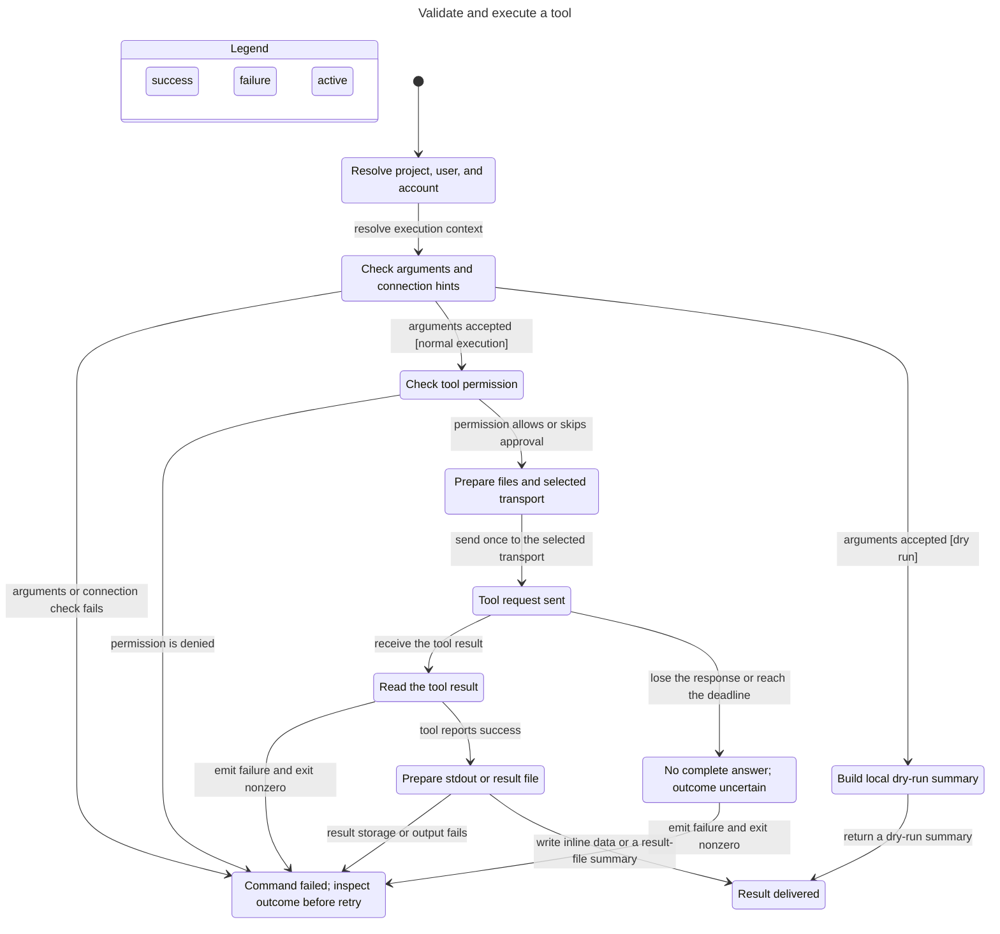

`DryRunDoesNotExecute` holds in 50 reachable states.

Negative control: Bypass the dry-run branch so the handler reaches the executor. The dry-run result contract must fail.

The shortest path has 4 steps: 0. Resolve project, user, and account

1. resolve execution context: Check arguments and connection hints
2. arguments accepted [normal execution]: Check tool permission
3. permission allows or skips approval: Prepare files and selected transport
4. send once to the selected transport: Tool request sent (tool sent during a dry run)

[Broken-copy chart](execution/counterexample.svg) · [Mermaid](execution/counterexample.mmd) · [Counterexample report](execution/counterexample-report.md)

### Listen and stop

[Skill and scope](../../../../../.agents/skills/verify-cli-listener/SKILL.md) · [SVG](listener/current.svg) · [Mermaid](listener/current.mmd) · [TLC report](listener/current-report.md)


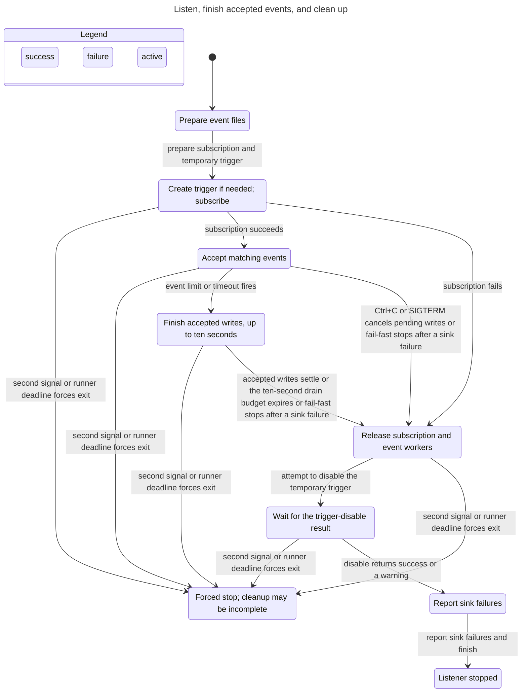

`CleanupAttemptBeforeCompletion` holds in 371 reachable states.

Negative control: Skip the temporary-trigger release call. The existing client test can no longer observe its failed disable request and warning, so its assertion must fail.

The shortest path has 4 steps: 0. Prepare event files

1. prepare subscription and temporary trigger: Create trigger if needed; subscribe
2. subscription fails: Release subscription and event workers
3. skip trigger cleanup: Report sink failures
4. report sink failures and finish: Stopped without attempting trigger cleanup

[Broken-copy chart](listener/counterexample.svg) · [Mermaid](listener/counterexample.mmd) · [Counterexample report](listener/counterexample-report.md)

### Stop a supervised script

[Skill and scope](../../../../../.agents/skills/verify-cli-shutdown/SKILL.md) · [SVG](shutdown/current.svg) · [Mermaid](shutdown/current.mmd) · [TLC report](shutdown/current-report.md)


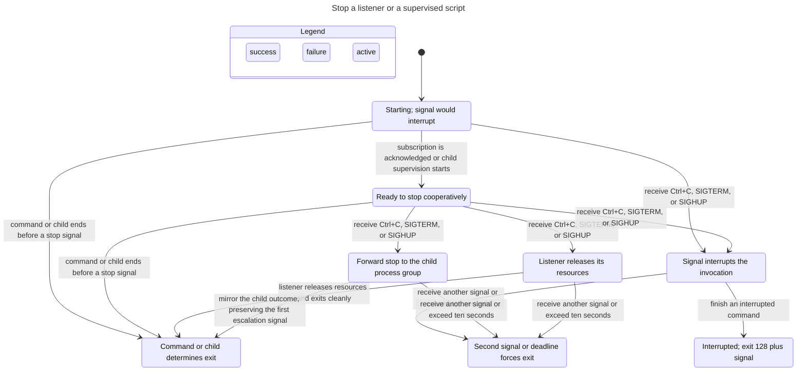

`CooperativeSignalIsNotInterruption` holds in 151 reachable states.

Negative control: Invert the runner cooperation branch while a cooperative command is still cleaning up. The existing in-progress-stop test must fail before the second signal.

The shortest path has 2 steps: 0. Starting; signal would interrupt

1. subscription is acknowledged or child supervision starts: Ready to stop cooperatively
2. receive Ctrl+C, SIGTERM, or SIGHUP: Signal interrupts the invocation (accepted stop incorrectly interrupted)

[Broken-copy chart](shutdown/counterexample.svg) · [Mermaid](shutdown/counterexample.mmd) · [Counterexample report](shutdown/counterexample-report.md)

### Parse, dispatch, and report

[Skill and scope](../../../../../.agents/skills/verify-cli-invocation/SKILL.md) · [SVG](invocation/current.svg) · [Mermaid](invocation/current.mmd) · [TLC report](invocation/current-report.md)


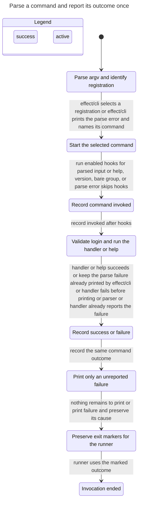

`HooksRequireParsedAction` holds in 46 reachable states.

Negative control: Run invocation hooks even without parsed input. The existing help/version/parse-error no-hook assertions must fail.

The shortest path has 2 steps: 0. Parse argv and identify registration

1. effect/cli selects a registration: Start the selected command
2. run enabled hooks for parsed input: Record command invoked (hooks ran without a parsed action)

[Broken-copy chart](invocation/counterexample.svg) · [Mermaid](invocation/counterexample.mmd) · [Counterexample report](invocation/counterexample-report.md)

## Behaviors to preserve

- Login caches expire by local `cachedAt`, not by the stored server `expiresAt`.
  Non-linked statuses are retried by the current generic polling helper. Interactive
  completion retains the pending file; `login --poll` clears it after success.
- `link --no-wait` returns a pending handoff. The additional-account alias check
  happens after the link request, so rejection does not prove no account was created.
- Account selection uses only active, enabled accounts. Without a selector, more
  than one usable account needs an explicit default alias. Blank selectors count
  as absent. This guarantee belongs to the high-level resolver.
- Dry runs can fetch schemas and resolve context. They send no tool execution.
  A lost response or a failed local output write can follow a completed remote action.
- Listener max-events counts accepted matches even when a sink fails. Normal
  stop drains accepted writes for at most ten seconds. A cooperative signal or
  fail-fast can cancel writes. Trigger disable is best-effort; forced exits can
  skip finalizers.
- Listener cooperation starts after subscription acknowledgment and covers INT
  and TERM. HUP and signals before registration interrupt normally. A supervised
  POSIX script receives forwarded signals, then TERM/KILL escalation if needed.
- Help, version, bare-group help, and parse failures skip invocation hooks.
  An own-action group is different. The parser can print an error before the
  invocation records its identity; already-reported failures retain their markers.

## Regenerate the charts

Use the current pstack `/statechart` skill, located by `pstack-skill path statechart`.
Read its instructions before running it; its command interface can change. Copy
the selected skill's `models/` files to a new scratch directory outside this repo,
then run the current statechart command on that module, its config, and `view.mjs`.
Use a new output directory. To reproduce the negative control, copy the config
and set `Mutant = TRUE`. Render each generated Mermaid file with Pele 1.9.0 as
the `/statechart` rendering reference describes, then copy reviewed outputs here.

The skills were created using pstack's current
[`create-formal-verification-skill`](https://github.com/backnotprop/pstack/tree/0b239bbfa26674efd5c371055eadfc5f488ac1be/skills/create-formal-verification-skill)
and [`statechart`](https://github.com/backnotprop/pstack/tree/0b239bbfa26674efd5c371055eadfc5f488ac1be/skills/statechart)
at revision `0b239bbfa26674efd5c371055eadfc5f488ac1be`, mirrored from
[`cursor/plugins/pstack`](https://github.com/cursor/plugins/tree/main/pstack).
The requested name `create-formal-specification` is absent from both current trees.
The managed dotfiles launcher was updated to this pin and verified against upstream.

For later source changes, use `/maintain-formal-verification-skill` to review
and refresh the relevant model before advancing its source hashes.

Historical orientation: Glen's “CLI authentication recovery” observations
`cmtx3f5ep003jgm0ao9jrr39g`, `cmtx3hrus001gl304di9665bo`, and
`cmtx4eih10005gm0aqtp9tm8f`; “CLI onboarding flow” observations
`cmt9yledq001qi504xz3cz36b` and `cmt9yleep001wi504nsux02a6`; and
“Composio CLI invocation identity design” observation `cmvqortrq0055l4082k635137`
helped prioritize the investigation. Current source and the recorded checks decide
the model's transitions.
